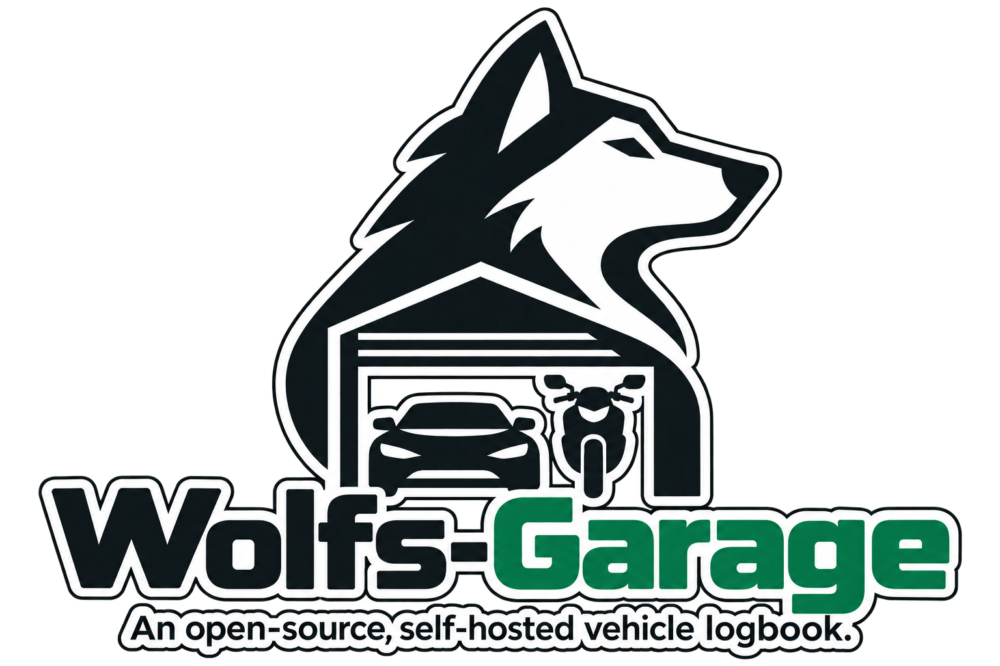

# Wolfs Garage



An open-source, self-hosted vehicle logbook with a focused mobile interface. Track cars and motorcycles, readiness, open work and completed maintenance. Original project code is licensed under [MIT](LICENSE); artwork and dependencies retain their [own notices](THIRD_PARTY_NOTICES.md).

## Current status

The standalone **0.1 alpha** has its own backend and SQLite database. It runs without LubeLogger. Existing installations using the legacy adapter are a separate deployment; no automatic migration or replacement happens when you run this alpha.

Available now:

- Navigate Garage, Sicherungen and Einstellungen from the header; the garage opens directly without an intro screen, and view changes preserve unsaved forms without writing them.
- Create and edit vehicles, vehicle types, units and identifying details.
- Maintain readiness and open issues independently. INOP marks an unusable vehicle; a wrench indicates open work, without a counter or green readiness check.
- Record dated odometer readings and completed service/repair work with costs and an optional HTTPS document reference.
- Correct linked work-record dates and odometer values with expected revisions, an explicit reason and an auditable atomic update; manually entered readings and legacy relationships use separate confirmation paths.
- Close a selected issue atomically with its work record and inspect the change history.
- Correct the description, service/repair kind, cost, currency and HTTPS document reference of a completed record, with a reason and before/after history. Those fields use the metadata-only route; date/odometer corrections use the separate measurement workflow, and unit/issue closure remain fixed.
- Browse complete service/repair and odometer histories in date-sorted pages with date filters; work records can also be filtered by kind.
- Set an optional due date, severity and open/observed lifecycle on existing open work; view active work in a Europe/Berlin date-aware dashboard.
- Edit an active issue from its detail row, or start a completed-work record from that issue. The record form drafts the issue description and defaults the date to today; saving explicitly creates the record and closes only that issue in one operation. Other open work and manually stored readiness remain unchanged.
- Record an inspection due month and view its Europe/Berlin status and separate effective-readiness projection under the owner's policy; unknown dates remain unknown.
- Set optional annual usage and view a clearly labeled Berlin-date estimate from the latest actual reading; a configurable Garage prompt asks for a real odometer reading after 30 days by default, or can be disabled. Estimates never become readings automatically.
- Download a portable owner-data JSON export, separate from the restorable SQLite backup.
- Download a consistent full SQLite backup separately from the portable JSON export; restore it only to a new database path with the explicit restore command.
- Choose system motion or reduced motion in local settings; the system choice respects the operating-system preference.

Recurring maintenance rules, photo and invoice uploads, parts inventory, Telegram, calendar integration and AI are still roadmap items. Following the user decision of 2026-10-29, maintenance planning and reliable 1.0 operation take priority over photo and invoice uploads; existing HTTPS document references remain available. Unclassified work remains explicitly unclassified; the app does not infer a severity. This is an early alpha, not the completed original feature list.

## Run locally

Docker Compose is the recommended starting point. Run from the repository root:

```sh
git clone https://github.com/DerPyro/wolfs-garage.git
cd wolfs-garage
docker compose --env-file .env.example -f deploy/compose.standalone.yaml build
docker compose --env-file .env.example -f deploy/compose.standalone.yaml run --rm --no-deps garage python -m wolfs_garage init-db
docker compose --env-file .env.example -f deploy/compose.standalone.yaml up -d
```

Open **http://localhost:8080**. Initialize a new database once only. The data volume persists across container recreation. Never reinitialize or remove it to repair an existing installation.

**Updating an existing standalone installation:** this source uses schema 6. If your database is schema 1–5, follow the [explicit backed-up upgrade procedure](docs/standalone.md#explicit-schema-upgrade-standalone-only) before starting the updated image. Never run `init-db` again for an existing database. Schema-1–5 images cannot open schema 6. The private reference database remains schema 5 until its separately approved schema-6 migration.

The default port is bound to loopback. There is no built-in login: access beyond the local machine requires an authenticated reverse proxy and the matching `GARAGE_PUBLIC_ORIGIN`. Origin checks prevent cross-site writes; they do not authenticate users. Cloudflare Access is one supported deployment approach, not a required external service.

See the [standalone guide](docs/standalone.md) for configuration, full database backups, isolated restore and development commands. The [backup/update workflow](docs/planning/backup-update-workflow.md) describes source/image pinning, restore rehearsal and rollback.

The private reference installation uses the [tested-main updater](docs/live-updates.md). This updater is specific to that installation; other self-hosters opt in separately and can keep using the Compose workflow above.

The source-build Compose setup above remains the supported install path. A pinned-image Compose file and release plan are prepared, but no GHCR image is published yet; see the [container release plan](docs/container-releases.md). The [changelog](CHANGELOG.md) currently contains unreleased entries.

## Project direction

Wolfs Garage is an independent application usable by other self-hosters. Each installation owns its configuration and vehicle data. Its core has no mandatory cloud API or LubeLogger dependency. The current access model is one trusted owner, with full access for any user admitted by the configured authentication boundary. The interface is currently in German.


- [Requirements](docs/requirements.md), [architecture](docs/architecture.md), [roadmap](docs/roadmap.md)
- [Date/odometer correction and measurement provenance contract](docs/planning/measurement-corrections.md)
- [Annual usage estimate and actual-reading prompt contract](docs/planning/mileage-forecast.md)
- [Active issue editing and completion workflow](docs/planning/work-completion.md)
- [Backend comparison](docs/planning/lubelogger-vs-own.md) and [decision to build an independent core](docs/adr/0009-backend-ownership-challenge.md)
- [Open-source preparation](docs/open-source-release.md), [contributing](CONTRIBUTING.md), [third-party notices](THIRD_PARTY_NOTICES.md)

The earlier [LubeLogger discovery](docs/discovery/lubelogger-runtime-verification.md) and [planning index](docs/planning/README.md) remain historical evidence. Historical deployment reports use anonymized placeholders and are not executable deployment instructions.
