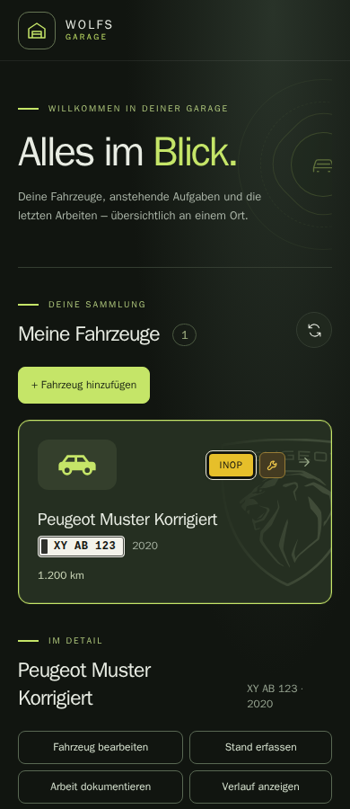

# Wolfs Garage

An open-source, self-hosted vehicle logbook with a focused mobile interface. Track cars and motorcycles, readiness, open work and completed maintenance. Original project code is licensed under [MIT](LICENSE); artwork and dependencies retain their [own notices](THIRD_PARTY_NOTICES.md).

## Current status

The standalone **0.1 alpha** has its own backend and SQLite database. It runs without LubeLogger. Existing installations using the legacy adapter are a separate deployment; no automatic migration or replacement happens when you run this alpha.

Available now:

- Create and edit vehicles, vehicle types, units and identifying details.
- Maintain readiness and open issues independently. INOP marks an unusable vehicle; a wrench indicates open work, without a counter or green readiness check.
- Record dated odometer readings and completed service/repair work with costs and an optional HTTPS document reference.
- Close a selected issue atomically with its work record and inspect the change history.
- Correct the description, service/repair kind, cost, currency and HTTPS document reference of a completed record, with a reason and before/after history. Record date, odometer reading, unit and issue closure remain fixed.
- Browse complete service/repair and odometer histories in date-sorted pages with date filters; work records can also be filtered by kind.
- Set an optional due date, severity and open/observed lifecycle on existing open work; view active work in a Europe/Berlin date-aware dashboard.
- Create consistent SQLite backups; the standalone tests include isolated restore and retry/concurrency cases.

Recurring maintenance rules, corrections to record dates or odometer readings, file uploads, parts inventory, Telegram, calendar integration and AI are still roadmap items. Unclassified work remains explicitly unclassified; the app does not infer a severity. This is an early alpha, not the completed original feature list.

## Run locally

Docker Compose is the recommended starting point. Run from the repository root:

```sh
git clone https://github.com/DerPyro/wolfs-garage.git
cd wolfs-garage
docker compose --env-file .env.example -f deploy/compose.standalone.yaml build
docker compose --env-file .env.example -f deploy/compose.standalone.yaml run --rm --no-deps garage python -m wolfs_garage init-db
docker compose --env-file .env.example -f deploy/compose.standalone.yaml up -d
```

Open **http://localhost:8080**. Initialize a new database once only. The data volume persists across container recreation. Never reinitialize or remove it to repair an existing installation.

**Updating an existing standalone installation:** this release uses schema 3. If your database is schema 1 or 2, follow the [explicit backed-up upgrade procedure](docs/standalone.md#explicit-schema-upgrade-standalone-only) before starting the updated image. Never run `init-db` again for an existing database. Do not run an older schema-2 image against an upgraded schema-3 database.

The default port is bound to loopback. There is no built-in login: access beyond the local machine requires an authenticated reverse proxy and the matching `GARAGE_PUBLIC_ORIGIN`. Origin checks prevent cross-site writes; they do not authenticate users. Cloudflare Access is one supported deployment approach, not a required external service.

See the [standalone guide](docs/standalone.md) for configuration, backup, isolated restore and development commands.

The source-build Compose setup above remains the supported install path. A pinned-image Compose file and release plan are prepared, but no GHCR image is published yet; see the [container release plan](docs/container-releases.md). The [changelog](CHANGELOG.md) currently contains unreleased entries.

## Project direction

Wolfs Garage is an independent application usable by other self-hosters. Each installation owns its configuration and vehicle data. Its core has no mandatory cloud API or LubeLogger dependency. The current access model is one trusted owner, with full access for any user admitted by the configured authentication boundary. The interface is currently in German.



- [Requirements](docs/requirements.md), [architecture](docs/architecture.md), [roadmap](docs/roadmap.md)
- [Backend comparison](docs/planning/lubelogger-vs-own.md) and [decision to build an independent core](docs/adr/0009-backend-ownership-challenge.md)
- [Open-source preparation](docs/open-source-release.md), [contributing](CONTRIBUTING.md), [third-party notices](THIRD_PARTY_NOTICES.md)

The earlier [LubeLogger discovery](docs/discovery/lubelogger-runtime-verification.md) and [planning index](docs/planning/README.md) remain historical evidence. Historical deployment reports use anonymized placeholders and are not executable deployment instructions.
