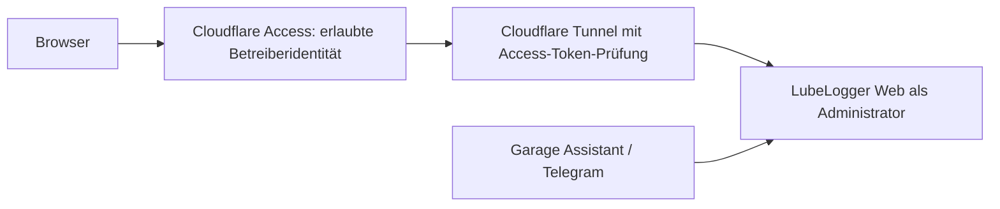

# ADR-0008 — Cloudflare-Anmeldung für eine einzelne Person mit Adminzugriff

Status: **Produktvorgabe durch Nutzer geklärt** · Datum: 2026-10-27 · Technische Ausgestaltung vorgeschlagen; Umsetzung und Nachweise offen

## Kontext und ausdrücklich geklärte Produktvorgabe

Der Nutzer betreibt Wolfs Garage nur für sich. Cloudflare Access soll vor der Webanwendung die Anmeldung übernehmen. Nach erfolgreicher Anmeldung erhalten zugelassene Personen vollständige Administratorrechte; es wird keine Benutzer-, Fahrzeug- oder Dokumenttrennung zwischen angemeldeten Webbenutzern als Produktfunktion benötigt. Die Nutzeranweisung legt diese vereinfachte Berechtigung fest; sie ist keine Freigabe für eine Cloudflare-Änderung oder ein Deployment.

Wir nehmen für die Planung an, dass die Access-Policy nur die Identität des Betreibers zulässt. Die konkrete Identität, der Anmeldeanbieter und der Wiederherstellungsweg sind noch nicht bekannt. Falls später andere Personen zugelassen werden, erhalten auch sie laut dieser Vorgabe Vollzugriff; eine Trennung wäre eine neue Produktentscheidung.

## Vorschlag für den Zugriffsweg

Cloudflare Access schützt die Web-Anmeldung; das bestehende LubeLogger-Frontend kann nach positivem Nachweis der Gesamtanforderungen wieder Ausgangspunkt für v1.0 sein. Der isolierte Origin ist nur über den vorgesehenen Tunnel und erforderliche interne Dienste erreichbar. Keine Router-Portfreigabe und kein öffentlich freigegebener LubeLogger-/Datenbankport. Der Connector prüft das gültige, zur Anwendung passende Access-Token, etwa mit **Protect with Access**; alternativ prüft ein vorgeschalteter eigener Dienst Signatur, Aussteller, Audience und Gültigkeit. Ein ungeprüftes Identitätsheader ist kein Authentifizierungsnachweis. Der interne Garage-Assistent ist kein Browser und nutzt einen getrennt geprüften internen Zugangsweg. Die Tokenprüfung beim Connector schützt nur Anfragen, die diesen Connector tatsächlich durchlaufen; Host-, LAN- und Containernetz-Bypässe sind separat zu verhindern und zu testen.

Offizielle Quellen: [Self-hosted-Anwendung veröffentlichen und Access-Token validieren](https://developers.cloudflare.com/cloudflare-one/access-controls/applications/http-apps/self-hosted-public-app/), [Protect with Access bei Tunnel-Origin](https://developers.cloudflare.com/cloudflare-one/networks/connectors/cloudflare-tunnel/configure-tunnels/origin-parameters/), abgerufen am 2026-10-27.

## Eine Anmeldung ohne zusätzliche Rollenverwaltung

Zu prüfen sind zwei technische Wege, die dieselbe Produktvorgabe erfüllen:

1. **Access als alleinige interaktive Web-Anmeldung** und LubeLogger ohne zusätzliche native Anmeldung, wenn die isolierte Architektur Access-Tokenprüfung für alle Webpfade garantiert und direkte Origins aus nicht vertrauenswürdigen Netzen nicht erreichbar sind. LubeLogger aktiviert Authentifizierung standardmäßig nicht; in diesem Modus dürfen auch interne Aufrufer nicht fälschlich als durch native API-Key-Rollen geschützt betrachtet werden. Alle erlaubten Originaufrufe erhalten die sich daraus ergebenden LubeLogger-Befugnisse. Ein eigener Garage-Dienst muss an seinem tatsächlichen Eingangs- bzw. Authentifizierungspunkt denselben gültigen Access-Zugriff oder einen ausdrücklich vorgesehenen internen Dienstzugang prüfen. Quelle: [LubeLogger-Authentifizierung](https://docs.lubelogger.com/Installation/Authentication/).
2. **Zusätzliche native Authentifizierung oder bestätigtes SSO**, falls Origin-Isolation, Recovery oder Dienstzugriff es erforderlich machen bzw. der Nutzer dies bevorzugt. Für echte Single-Sign-on-Bedienung ist die konkrete Kompatibilität des gewählten Identity-Providers mit LubeLogger zu prüfen; eine automatische Anmeldung nach Cloudflare Access ist derzeit nicht nachgewiesen. Zusätzliche Logins werden nicht stillschweigend als Voraussetzung für das gewünschte Nutzungserlebnis beschlossen.

Empfohlener Ausgangspunkt ist Weg 1 als einfacher Entwurf, unter dem Vorbehalt der obigen Isolations-, JWT- und Wiederherstellungstests. REQ-042 wurde aufgrund der ausdrücklichen Nutzerklärung auf ein interaktives Cloudflare-Login und Administratorrechte für zugelassene Nutzer präzisiert; zusätzliche Origin-/Dienstzugangsprüfungen bleiben relevant. Das Ersetzen zusätzlicher Nutzer-/Fahrzeugrollen durch einen einzigen vertrauenswürdigen Admin bedeutet keine Freigabe eines öffentlich oder unkontrolliert intern erreichbaren Origins. AGENTS.md verlangt weiterhin serverseitig geprüfte Berechtigung; im vorgeschlagenen Webpfad erfolgt diese Prüfung anhand einer validierten Access-Identität an einer vertrauenswürdigen Servergrenze, die alle erlaubten Browserpfade durchlaufen müssen. Ein Header, den externe Clients selbst setzen können, reicht nicht. Details des späteren Garage-Dienstzugangs sind gesondert vor Implementierung und mit Negativtests festzulegen.

## Bedeutung der bisherigen WP01-Befunde

Die [WP01-Prüfung](../discovery/wp01-runtime-verification.md) zeigte: Ein angemeldeter Außenseiter konnte bekannte native Dokumente lesen, und Household-View/Viewer-Key verhinderte nicht alle Schreibwirkungen. Für das nun geklärte Produktmodell, in dem ausschließlich zugelassene Web-Admins Zugriff haben und es keine unterschiedlichen Fahrzeug-/Dokumentrechte geben soll, sind **fehlende Trennung zwischen solchen angemeldeten Personen und fehlende native Read-only-Rollen keine eigenständigen Produktanforderungen mehr**. Die Gegenbeispiele bleiben gültige Beobachtungen, erfordern aber für diesen Umfang keine separate Rollenarchitektur und kein eigenes Garage-Frontend allein zur Durchsetzung dieser Trennung.

Der anonyme bzw. nicht von Access zugelassene Zugriff auf App, API, Dokumente, Upload-/Temp-/Previewpfade und direkte Origin-Adressen muss weiterhin ausgeschlossen sein. Paperless kann als Dokumentquelle verwendet werden; eigene Zugangseinstellungen und Linkprüfung bleiben zu prüfen. Der Produktscope ändert weder das technisch beobachtete LubeLogger-Verhalten noch die Notwendigkeit, Backups mit Dokumenten geschützt aufzubewahren.

Die übrigen WP01-Befunde sind davon unabhängig: Native und öffentliche Kilometer-GETs können alte Startstände verändern; eine Steuer-Prüfaktion kann Folgebelege erzeugen; native Cookie-Formulare akzeptierten in der Sandbox einen manuell injizierten Cookie bei fremdem Origin ohne Token. Letzteres ist **kein** vollständiger Browser-CSRF-Nachweis. Ob diese Effekte fachlich akzeptabel sind, braucht reproduzierbare Prüfungen, geeignete Konfiguration und insbesondere bei CSRF einen Browser-/Access-Test. Keine vollständige Produktionssicherheit aus den bisherigen Tests ableiten.

## Unveränderte fachliche Grenzen

REQ-043 fordert weiterhin ein Änderungsprotokoll für Wartung und Logbuch; REQ-020 fordert nachvollziehbare unveränderliche Problemhistorie. Dass der Nutzer Administrator ist, entscheidet diese Anforderungen nicht ab. Insbesondere ist ein vollständiger Nachweis für direkte native LubeLogger-Änderungen bisher offen. Ein Audit-Write-Gateway nur zur Verhinderung fremder Admin-Writes ist nicht aus dem Rollenwunsch abzuleiten; die erforderliche fachliche Auditabdeckung wird gesondert anhand von REQ-043 und tatsächlichem Nutzen geklärt. Auch fehlerhafte Datumsberechnung, API-Grenzen, Backups/Restore und Kalendererinnerungen bleiben eigenständige Aufgaben.

Der Telegram-Assistent ist eine gesonderte externe Schnittstelle: numerische Telegram-User-ID erlauben, Update-Identität serverseitig prüfen, schreibende Aktionen wie beauftragt bestätigen und protokollieren. Cloudflare-Browserlogin ersetzt keine Telegram-Authentifizierung. Secrets, API-Zugang, externe Datenübermittlung und KI-Bestätigungen bleiben nach AGENTS.md und den bestehenden Anforderungen geschützt.

## Offene Arbeit und Abnahme

- Web: Access-App und Policy auf Betreiberidentität beschränken; alle externen Browserpfade nur nach gültigem Zugriff erreichbar. Nicht angemeldete/falsche Identität ablehnen, Access-Ausfall und Login-Recovery dokumentieren.
- Origin: Web-/Datei-/API- und alternative Routen aus fremden LAN-/Host-/Containernetz-Segmenten testen; keine Direktverbindung ermöglichen. API-/Bot-Dienstzugang, Secrets und Vertrauensgrenzen festlegen.
- Connector: Access-Tokenprüfung mit korrekter Anwendungsaudience nachweisen, falsche/fehlende/abgelaufene Signatur und gefälschte Header ablehnen. Path-Normalisierung und Auth-/Appabdeckung über alle veröffentlichten Routen prüfen.
- Auth-Variante: Benutzererlebnis und Notfallzugang testen; natives Login/SSO nur bei entsprechend gewählter Variante aktivieren. Die Sandbox-Befunde erneut gegen die tatsächlich gewählte Zielversion verifizieren.
- Fachlich: Auditumfang, Side-Effect-Reads, Datumslogik und Dokumentzuordnung getrennt abnehmen; keine Produktfreigabe allein aus bestandenen Zugangstests.

Nicht in diesem Schritt: Cloudflare-Ressourcen erstellen oder ändern, produktive native Auth umstellen, Dienste veröffentlichen, produktive Daten migrieren oder löschen. Hierfür gelten die ausdrücklich benannten Freigaben aus AGENTS.md. Die zusammenführende Architektur-/Roadmap-Arbeit hat die ältere Rollen- und Doppelloginannahme aktualisiert; historische Testberichte bleiben als Evidenz erhalten.

[Isolierter Auth-off-Test](../discovery/single-owner-access.md): neun Checks bestätigen, dass interne Aufrufer ohne native Auth root sind und API-Key-Rollen keinen Schutz bieten. Kein Test einer tatsächlichen Cloudflare-Konfiguration oder Produktivfreigabe.
