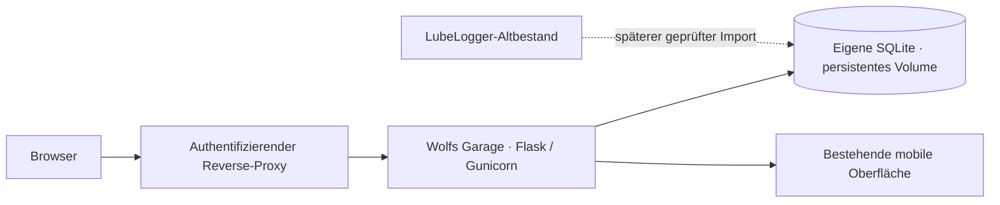

# Architektur — eigenständiger Kern und historische Entwürfe

## Eigenständiger Kern — entschieden am 2026-10-28

Der Nutzer hat die eigenständige Entwicklung und MIT als Lizenz gewählt: [ADR-0009](adr/0009-backend-ownership-challenge.md), [ADR-0010](adr/0010-open-source-mit.md). Der erste Alpha-Kern ist als modularer Flask-Dienst mit SQLite und der bestehenden Oberfläche implementiert. Gunicorn bedient HTTP; ein authentifizierender Reverse-Proxy schützt nicht-lokalen Zugriff. Die generische Compose-Datei bindet den Port nur auf Loopback. Keine Rollenplattform oder Microservices werden benötigt.



Der Standalone-Kern führt Fahrzeuge mit stabilen lokalen IDs, Kilometer, Bereitschaft/offene Punkte, Service-/Reparaturbelege, Dokumentreferenzen und Änderungsverlauf. Bestehende offene Punkte können ein optionales Fälligkeitsdatum, eine manuell gesetzte nullable Schwere und den Status `open` oder `observed` tragen. Ein expliziter Problemabschluss und sein Beleg werden in derselben Transaktion gespeichert; die Fahrbereitschaft ändert sich nur ausdrücklich. Record-/Kilometer-Command-IDs verhindern Doppelanlage bei Wiederholung. Belege haben Revisionen; die begrenzte Korrektur ersetzt Beschreibung, Art, Kosten und Dokumentreferenz nur mit Begründung und Vorher-/Nachher-Audit. Datum, Kilometerstand, Einheit und abgeschlossener Problembezug bleiben unverändert. Datenbanken werden bewusst initialisiert; Schema 1 und 2 können ausschließlich über ein explizites Upgrade mit geprüfter Vorab-Sicherung auf Schema 3 weitergeführt werden. Fehlende oder inkompatible Dateien führen zu Fehlern statt zu leeren Ersatzbeständen.

Der Kern ruft keine LubeLogger- oder Cloud-API auf. Die bisherige Instanz bleibt während der eigenständigen Entwicklung erhalten. Das Anwendungsschema ist Version 3; ältere Versionen werden nicht beim Start migriert. Schema 1 und 2 haben einen expliziten, geprüften Backup- und Upgradepfad; bei Schema 1 wird zusätzlich die Record-Revision ergänzt. Ein Schema-3-Aufruf ist ein No-op ohne Backup. Ein älteres Anwendungsimage muss gegen eine separate Vorkopie zurückkehren und darf nicht mit einer Schema-3-Datenbank gestartet werden. Korrekturen von Belegdatum und Kilometerstand, wiederkehrende Regeln, Datei-Uploads, Teile und externe Integrationen bleiben weitere Arbeit. Der ältere Python-Adapter bleibt als Legacy-Integrationscode getrennt erhalten. [Standalone-Anleitung](standalone.md), [Korrekturvertrag und Abnahmeannahmen](planning/record-corrections.md), [Entscheidungsgrundlage](planning/lubelogger-vs-own.md).

Die eigenständige Oberfläche kann abgeschlossene Vorgänge und Kilometerstände in paginierten, absteigend nach Datum und stabiler Zeilen-ID sortierten Listen anzeigen. Die API verwendet gebundene Fortsetzungscursor und liest je Seite Daten sowie die aktuelle fahrzeugbezogene Audit-Sequenz in einer SQLite-Lesetransaktion. Änderungen am Fahrzeug machen ältere Cursor ungültig, damit nachträglich erfasste, rückdatierte Einträge oder korrigierte Vorgangsarten nicht still zu Lücken oder Duplikaten führen. Der eigene Audit-Verlauf bleibt ein separater, unveränderter Endpunkt. Vertrag und Abnahmefälle: [History browsing](planning/history-browsing.md).

Das Fälligkeits-Dashboard ist eine lesende Projektion über aktive Punkte (Lifecycle `open` oder `observed`), nicht eine Regel- oder Erinnerungsengine. Die Statusrevision, der manuelle Schweregrad und das optionale Datum sind führend im Fahrzeugstatus. Die aktuelle Tagesgrenze wird einmal innerhalb derselben SQLite-Lesetransaktion aus `Europe/Berlin` ermittelt; UTC-Zeitpunkte kurz vor oder nach lokaler Mitternacht ergeben daher den passenden Berliner Kalendertag. Nicht eingestufte Punkte bleiben `null` statt automatisch diagnostiziert zu werden. Der Endpunkt erzeugt keine zusätzlichen Audit-Ereignisse. Vertrag und Abnahmefälle: [Scheduled work](planning/scheduled-work.md).

Der portable Owner-Datenexport ist eine versionierte Einweg-JSON-Projektion aller Geschäfts- und Auditdaten aus einer einzigen SQLite-Lesetransaktion. Der Export behält gespeicherte Dezimalstrings bei, dekodiert ältere Audit-Snapshots typgetreu und schließt Befehlswiederholungen, Konfiguration/Secrets, abgeleitete Projektionen und externe Dokumentbytes aus. Er wird weder importiert noch zur Wiederherstellung verwendet. SQLite-Backups bleiben der vollständige Restorepfad inklusive Command-Replay-Daten. Vertrag und Bedienung: [Owner data export](data-export.md).

## Historischer Phase-0-Zielentwurf

Die folgenden Abschnitte dokumentieren frühere, teilweise inzwischen ersetzte Architekturvorschläge. Ihr damaliger Status ist keine Beschreibung des heutigen Produktumfangs.

Stand: 2026-10-26. Keine Dienste implementiert. Die [ADRs](adr/README.md) unterscheiden geklärte Produktvorgaben von vorgeschlagenen technischen Entscheidungen; Produktanforderungen bleiben verbindlich. [Bestandsaufnahme und Annahmen](discovery/phase-0.md).

## Komponenten und Phasengrenzen

```mermaid
flowchart LR
  U[Browser] --> CF[Cloudflare Access und Tunnel]
  CF --> LL[LubeLogger Web · v1.0]
  CF -. bei belegter UI-Lücke .-> WEB[Garage Web · frühestens Ergänzung]
  WEB --> G[Garage Spring Boot · v1.1]
  G --> LA[LubeLogger-Adapter]
  LA --> LL
  G --> PA[Paperless-Adapter]
  PA --> PL[Bestehendes Paperless-ngx]
  G --> CA[Kalender-Adapter und Outbox]
  CA --> CAL[Google Calendar]
  G --> DB[(Garage DB · Vorschlag PostgreSQL)]
  G --> TA[Telegram-Adapter · Long Polling]
  TA --> T[Telegram Bot API]
  G -. explizit freigegebene Daten · v2.0 .-> AI[KI-Adapter]
```

Telegram-Pfeil beschreibt ausgehende Polling-/Send-Verbindungen; kein eingehender öffentlicher Bot-Endpunkt. Jede Integration erhält einen überprüften Zugangsweg; Credentials oder Netzgrenzen werden abhängig vom gewählten Authentifizierungsmodus eingerichtet. Wenn LubeLogger-Auth deaktiviert ist, kann kein Schutz durch dessen API-Key-Rollen behauptet werden. LubeLogger bleibt unabhängig vom Garage-Service bedienbar. Ein modularer Garage-Service bündelt Domäne, Scheduler und Adapter; separate Microservices sind nicht vorgesehen.

Für v1.0 ist die vorhandene LubeLogger-Oberfläche für Fahrzeuge, Kilometer, Wartung, Reparaturen und Kosten wieder der bevorzugte Ausgangspunkt. Der Nutzer hat klargestellt, dass alle zugelassenen Webnutzer volle Adminrechte erhalten; eine native Read-only-Ansicht ist dafür nicht erforderlich. Zugang über Cloudflare und fachliche Abnahme sind noch nachzuweisen. Eigene Oberfläche erst nach dokumentierter Abdeckungslücke, insbesondere Ampel und technisches Logbuch. v1.1 ergänzt Garage-Persistenz, Bot und Integrationen. v2.0 ergänzt beratende KI ohne direkte Schreibrechte. [Compose-Design](../deploy/compose.design.yaml) enthält nur Metadaten und `services: {}`; es kann keine Dienste starten.

## Datenmodell und Hoheit

| Aggregat | Führendes System | Minimale fachliche Struktur / Grenze |
| --- | --- | --- |
| Vehicle | LubeLogger | Marke, Modell, Baujahr, Einheit, Motorisierung/Zusatzfelder; Garage UUID ↔ Instanz/Provider-ID |
| OdometerReading | LubeLogger | Datum, Strecke/Einheit, Herkunft; Rückdatierung/Korrektur explizit behandeln |
| Maintenance/Repair, Cost, Supply | LubeLogger | Vorgang, Datum, Kilometer, Kosten, Teile; keine doppelte Kostenaggregation |
| MaintenanceRule / DueTask | v1.0 zunächst LubeLogger-UI; v1.1 offen | Quelle, Zeit-/km-Intervall, frühere Grenze, nächste Fälligkeit, bestätigte Durchführung; nur ein Regel-Owner |
| Problem / ProblemEvent | Garage | Fahrzeug, Schweregrad, Status, append-only Ereignisse, verknüpfte frühere Fälle |
| DocumentReference | Garage → Paperless | Instanz/ID, Fahrzeug/Vorgang, Kategorie; Original und Rechte bei Paperless |
| ConfirmedCommand / AuditEvent | Garage | Actor, Inhaltshash, Ablauf/Bestätigung, Revision, Ergebnis |
| Inbox / Outbox / Delivery / CalendarMapping | Garage | Update-/Operations-ID, Fälligkeitsrevision, Status, Provider-ID/ETag |
| ManufacturerSource / AiSuggestion | Garage | Quellenbeleg und Gültigkeit getrennt von Vorschlag/Unsicherheit |

Garage besitzt keine zweite editierbare Fahrzeug-/Kostenkopie. Caches kennzeichnen Herkunft und Lesestand. Fälligkeiten als lokale Daten, Audit-Zeitpunkte als UTC, Berechnung in Europe/Berlin. Kilometerprognosen sind Schätzungen. Statusänderungen eines Problems erzeugen neue Ereignisse. Korrekturen überschreiben nicht still die Historie. Konkrete Tabellen, Constraints und Aufbewahrung vor Implementierung festlegen.

## Validierte Integrationsgrenzen

Die [LubeLogger-Prüfung](discovery/lubelogger.md) untersucht v1.7.4 anhand eines gepinnten Release-Commits: MIT, öffentliche API und API-Key-Rollen vorhanden. Wiederholungs-/Refresh-Felder der Reminder fehlen jedoch im geprüften öffentlichen API-Vertrag. Für v1.1 muss API-Erweiterung oder Garage-Regelhoheit entschieden werden. Keine privaten UI-Routen und keine direkten LubeLogger-DB-Zugriffe.

[Paperless-/Kalenderverträge](discovery/integration-contracts.md) dokumentieren belegte externe Endpunkte getrennt von vorgeschlagenen internen Operationen. Dokumente möglichst referenzieren. Kalender ist eine Projektion bestätigter Fristen, keine Quelle einer erledigten Wartung. Google erlaubt native Reminder höchstens 28 Tage vorher; für REQ-011 ist ein separates 30-Tage-Ereignis vorgeschlagen. Diese Alternative ist noch nicht beschlossen.

REQ-043 verlangt ein Änderungsprotokoll für Wartungs- und Logbucheinträge. Die tatsächlich von LubeLogger verfügbare Nachvollziehbarkeit und verbleibende Lücken werden unabhängig vom Adminmodell geprüft. Ein lückenloser Vorher-/Nachher-Nachweis aller nativen Aktionen war eine frühere technische Annahme und wurde vom Nutzer nicht gesondert gefordert; Webhooks und Snapshots werden dennoch nicht als lückenloses Audit dargestellt. REQ-020 bleibt für die Problemhistorie bestehen.

## Schreibablauf und Fehlerverhalten

1. Actor und Fahrzeug serverseitig autorisieren; natürliche Sprache nur als Entwurf interpretieren.
2. Entwurf mit Einheit, Datum, Aktion und Werten anzeigen, Nutzerbestätigung an Inhalt/Revision/Ablauf binden.
3. Bei Bestätigung erneut prüfen; Auftrag und Audit/Outbox atomar speichern.
4. Adapter ruft ausschließlich freigegebene Operationen auf; bei LubeLogger auch `OperationResponse.Success` prüfen, HTTP 2xx allein genügt nicht.
5. Ergebnis als erfolgreich, ausstehend, fehlgeschlagen oder unklar anzeigen. Unklarer externer POST nach Timeout wird abgeglichen, nicht blind erneut gesendet.
6. Periodisch Providerzustand abgleichen; Webhooks optional als Hinweis. Ausfall von Kalender/Paperless/KI blockiert lokale Basisverwaltung nicht.

Für Reminder/Scheduler eindeutige Zustellschlüssel und fachliche Revisionen verwenden. Externe APIs garantieren keine systemübergreifende Exactly-once-Zustellung; REQ-032 benötigt eine festgelegte Strategie bei unklarer Telegram-Zustellung. API-Konflikte ohne Provider-Locking bleiben als Restrisiko sichtbar.

## Betrieb und Sicherheit

Docker auf dediziertem Proxmox-Gast; VM vorgeschlagen, unprivilegierter LXC nach Prüfung weiterhin Alternative. Keine Router-Portfreigaben, DB-Ports oder Docker-Socket-Mounts. Ein interaktives Cloudflare-Access-Login mit globalem Adminzugriff; Isolation und Prüfung der Access-Identität für alle erlaubten Webwege. Native Anmeldung nur, falls sie transparent integriert wird oder sich bei der Prüfung als nötig erweist; Dienstzugänge separat absichern. Telegram numerische User-ID-Allowlist, privater Chat, dauerhafte Inbox, Bestätigung vor Änderungen. Keine Datenweitergabe an KI vor gesonderter Entscheidung.

[Operations/Security](discovery/operations-security.md) beschreibt Secretverwaltung, Netze, Backup und isolierten Restore. Wiederherstellung umfasst Daten, Anhänge, Provider-Zuordnungen und Schlüssel; Outbox/Scheduler bleiben zunächst pausiert. RPO/RTO, Retention, Versionen und Digests sind offen. Das [Abnahmeprogramm](discovery/validation.md) ist nur teilweise durch B01/B02 abgedeckt; Host-/Produktivabnahme bleibt offen.

## B01/B02 — nachgewiesene Grenzen der Testbaseline

Die [lokale Erprobung](discovery/lubelogger-runtime-verification.md) ergänzt den ursprünglichen statischen Entwurf: 62 Checks, 51 bestätigte Verträge und 11 reproduzierte Grenzen; beide Testinstanzen danach gestoppt. [Version und Image-Digest](../tests/lubelogger/target.lock.json) sind für die Erprobung fixiert. Kern-CRUD, Rollen, Datenformate und Anwendungsrestore funktionieren im geprüften Umfang.

Neue Freigabeblocker: Native Dokumentpfade begrenzen angemeldete Nutzer nicht auf ihre Fahrzeuge (B16). Provider-DueDays und Custom-Threshold-Dringlichkeit entsprechen nicht zuverlässig der fachlichen Tages-/Regelsemantik; GET-Autorefresh muss aus bleiben (B17). Die Vorschläge zur Abhilfe sind in ADR-0003/0004 dokumentiert. API-Wartungsanlage erledigt weder ausgewählte Reminder noch Teileverwendung. Keine visuelle UI-, vollständige Audit- oder Produktivabnahme erfolgt.

## Vertiefter Zielentwurf und offene Scopeentscheidung

[Umsetzungsplanung](planning/README.md): ER-/Persistenzmodell, 27 fachliche Rechenvektoren, eigene HTTP-/JSON-Verträge, UI-/Bot-/KI-Flows, Betriebsrunbooks und Threatmodell. Nur Offline-Spezifikationskonsistenz ist in diesem Schritt geprüft; keine Dienste implementiert. [ADR-0006](adr/0006-audit-write-boundary.md) untersucht einen kontrollierten Audit-Schreibweg; [ADR-0007](adr/0007-rule-ownership-transition.md) empfiehlt Garage-Regelhoheit ab dem zu entscheidenden Übergang. Beide sind vorgeschlagen.

Wichtige Präzisierung des Zielentwurfs: Eine ausdrücklich bestätigte tatsächliche Durchführung kann lokal mit Audit, Fristprojektion und Outbox atomar erfasst sein, während der LubeLogger-Beleg noch pending/uncertain bleibt. Diese Fakten werden getrennt dargestellt; ein Syncfehler bedeutet keine zweite physische Durchführung. Bestätigte Fristen, geschätzte Kilometertermine und reine Datenalter-/Reviewflags bleiben getrennte Dimensionen. Die bestehenden Phasengrenzen ändern sich erst nach der dokumentierten Scopeentscheidung.

## WP01-Machbarkeitsergebnis — 2026-10-27

[WP01](discovery/wp01-runtime-verification.md) trennt die bisher nur hypothetischen Grenzen: Household-View verhindert ausgewählte direkte Saves, aber nicht persistierende Kilometer-GETs oder Taxfortschreibung. Auch der öffentliche Kilometer-GET unter Viewer-Key ist kein reiner Read; API-Viewer kann Dateien hochladen. Native Dokumentbytes bleiben nach Rechteentzug und Restore für angemeldeten Outsider lesbar.

Die native Oberfläche allein mit Rollen „read-only“ abzugrenzen ist damit für v1.7.4 keine ausreichende Basis von ADR-0006. Eine minimale Positivliste zweier API-Leseoperationen ist demonstriert, nicht jedoch ein vollständiger nativer UI-/Auditschutzproxy oder eine unerreichbare Originzone. Aktuelle **Empfehlung**, keine akzeptierte Scopeänderung: schmalen Garage-Zugang mit eigener kontrollierter Anzeige/Commands und interner LubeLogger-Anbindung konkretisieren; fehlende öffentliche Teile-/Recurrenceoperationen bleiben separate Gates. B03/B16 und produktive Session-/Netzgrenzen sind weiter offen.

## Geklärter Einzelnutzerzugang — 2026-10-27

Der Nutzer möchte **ein Cloudflare-Login und danach volle Adminrechte**. Es gibt keine produktseitige Mehrnutzer-/Fahrzeugrechte-Trennung zwischen zugelassenen Webnutzern. [ADR-0008](adr/0008-single-user-access.md) dokumentiert den Vorschlag: Access-Policy für die Betreiberidentität, Tunnel, validiertes Anwendungstoken und isolierter Origin. Separate interaktive LubeLogger-Anmeldung wird nicht vorausgesetzt; ohne native Authentifizierung sind interne API-Zugriffe ebenfalls nicht durch native API-Key-Rollen beschränkt. Die tatsächliche Netz-/Token-/Dienstzugangssituation bleibt vor einer Bereitstellung zu prüfen.

WP01 bleibt historische Evidenz zu LubeLogger, aber sein rollenbezogenes Read-only-Ergebnis ist **kein eigenständiger Blocker** des neuen Ein-Admin-Produktumfangs. Die wegen dieser Annahme vorgeschlagene vorgezogene Eigenoberfläche wird nicht mehr vorausgesetzt. LubeLogger ist zunächst wieder der Kandidat für die Basisoberfläche. Datengenauigkeit, Zeit-/Kilometerseitenwirkungen, Backup, das geforderte Änderungsprotokoll und der getrennte Telegram-Zugang bleiben zu prüfen. Keine Cloudflare-Änderung oder produktive Implementierung autorisiert.

## Laufzeitfortschreibung für eine Person — 2026-10-27

[Auth-off-Test](discovery/single-owner-access.md): neun isolierte Checks bestätigen die gewünschte Oberfläche ohne zweite native Anmeldung. Jeder interne Origin-Aufruf ist in dieser Variante automatisch Root; ein ungültiger API-Key begrenzt ihn nicht. Ein Cloudflare-Login und eine geeignete Netzgrenze werden dadurch **nicht** bereits nachgewiesen. Die getrennte [lesende Cloudflare-Inventur](discovery/cloudflare-readonly-inventory.md) fand eine aktive passende Zonen-Kandidatin, einen vorhandenen One-Time-PIN-IdP und einen gesunden lokal verwalteten Tunnel; es wurde nichts geändert und keine Adresse gewählt. [SSO-Alternativen](discovery/access-sso-feasibility.md) bleiben ungeprüft.

[WP02 Funktion](discovery/wp02-functional.md): Fünf synthetische Fahrzeuge, Teileentnahme und getestete Jahreskosten funktionieren; eine überfällige Fahrzeugkachel zeigt bei Kilometerstand 0 in diesem Fall keine Glocke. Meilen-/Kilometer-Umschaltung ändert die Anzeigeeinheit ohne entsprechende Änderung der geprüften gespeicherten Zahlen. Vollständige Zahlungshistorie ist weiterhin nicht nachgewiesen. [WP02 Audit](discovery/wp02-audit-assessment.md): Die native Fahrzeughistorie zeigt aktuelle Belege, aber weder frühere Bearbeitungsstände noch gelöschte Einträge; lokale Webhook-Ereignisse können einen eingeschränkten Aktivitätsverlauf ergänzen. REQ-043/020 werden damit nicht pauschal als erfüllt erklärt.
