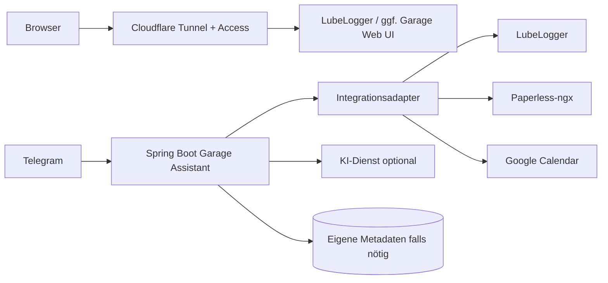

# Architektur — Entwurf

Deployment: Docker auf Proxmox, bevorzugt isolierter LXC. Bestehende Dienste wie Paperless über abgesicherte interne Verbindungen. Bot-Nachrichten dürfen nur von erlaubter Telegram-ID verarbeitet werden. Cloudflare Access schützt die Weboberfläche; API- und Serviceauthentifizierung bleiben eigenständig.

Wichtig: Ob LubeLogger die vollständigen benötigten Schreib-/Leseoperationen anbietet, ist noch offen. Keine direkte Manipulation der LubeLogger-Datenbank planen, bevor Kompatibilität und Updatefähigkeit geklärt sind. Für technische Logbücher kann ein separater Garage-Service mit eigener Persistenz erforderlich werden.

Die KI ist beratend, nicht entscheidend: Diagnoseergebnisse mit Quellen, Konfidenz und Sicherheitsgrenzen. Änderungen an Fahrzeugdaten sind nachvollziehbar und bestätigungspflichtig.
