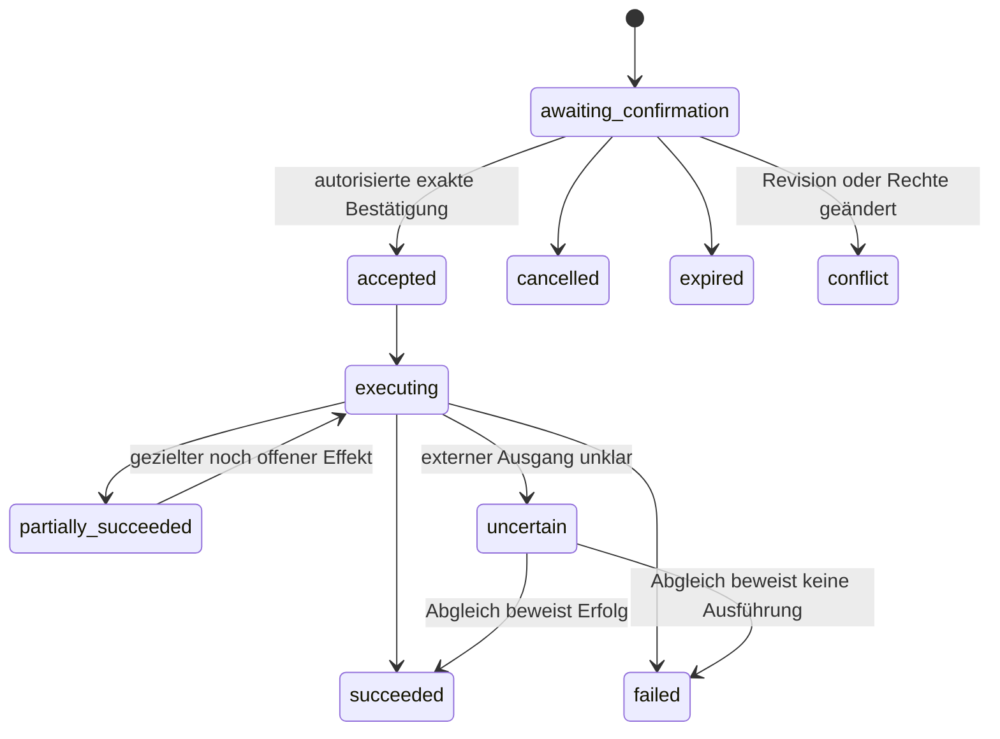

# API-, Befehls- und Konsistenzvertrag — Entwurf 0.1

Stand: 2026-10-26. Die Dateien unter [contracts/](contracts/garage.openapi.yaml) beschreiben **eigene künftige Garage-Endpunkte**. Keine dieser Routen existiert bereits; es handelt sich weder um neue LubeLogger-Endpunkte noch um eine Implementierung. LubeLogger-/Paperless-Verträge bleiben separat in der [Discovery](../discovery/integration-contracts.md). OpenAPI 3.1.1 ist bewusst als konkrete Dokumentversion gewählt, keine Behauptung über den neuesten Standard.

> **Einzelnutzer-Fortschreibung 2026-10-27:** Cloudflare ist das einzige gewünschte interaktive Web-Login; alle zugelassenen Webnutzer erhalten globale Adminrechte. Ein künftig eigener Garage-Service kann zur CSRF-/Dialogsteuerung automatisch eine interne Session aus der serverseitig geprüften Access-Identität erhalten, ohne eine zweite interaktive Anmeldung. Per-Fahrzeug-/Dokumentrollen zwischen zugelassenen Admins sind nicht erforderlich. Ursprungskontrolle, gültige Identität, referenzielle Integrität und der separate Telegram-Zugang bleiben relevant. [ADR-0008](../adr/0008-single-user-access.md).

## Umfang und Schnittstelle

Der Entwurf spezifiziert sechs Schreibabsichten: Kilometer erfassen, Wartung/Reparatur erfassen, Problem anlegen, Problemereignis ergänzen, bestätigte HU-Durchführung erfassen und Paperless-Dokument referenzieren. Alle laufen über Entwurf → Bestätigung → Status. Direkte CRUD-Änderungen an bestätigten Wartungs-/Problemdaten sind nicht als Hintertür vorgesehen. Fahrzeugstammdaten, vollständige Regelkonfiguration, historische Korrektur-/Löschoperationen, OBD- und KI-Endpunkte folgen erst nach deren Fach- und Berechtigungsentscheidungen; das ist kein vollständiges Produkt-API.

| Vorgeschlagene eigene Route unter `/garage-api/v1` | Verhalten |
| --- | --- |
| `POST /command-drafts` | Autorisieren, Payload/Capabilities/aktuellen Datenstand prüfen, Entwurf speichern, Vorschau und befristete Nonce zurückgeben; kein Provider-Write |
| `POST /commands/{commandId}/confirm` | Exakten Entwurf erneut autorisieren und atomar akzeptieren; asynchrone Effekte zunächst als pending ausweisen |
| `GET /commands/{commandId}` | Eigenen berechtigten Status lesen, keine Nonce/Provider-Secrets zurückgeben |
| `POST /commands/{commandId}/cancel` | Ausschließlich noch unbestätigten Entwurf abbrechen; kein Rückgängigmachen bereits gesendeter Effekte |
| `GET /due-tasks` | Berechtigte Fälligkeitsprojektion, Cursor und Datenalter; keine aus LL-Urgency behauptete eigene Regelwahrheit |

Schemas: [command.schema.json](contracts/command.schema.json), eigene [OpenAPI-Datei](contracts/garage.openapi.yaml), ausschließlich synthetische [Beispiele](contracts/examples/draft-odometer.json). JSON-Objekte sind geschlossen (`additionalProperties: false`), damit u. a. `actorId`, `chatId`, `confirmedAt` oder fremde Berechtigungsfelder nicht über Client-Mass-Assignment übernommen werden. Diese Werte ermittelt ausschließlich der Server aus seiner geprüften Session bzw. dem allowlist-geprüften Telegram-Update.

## Identität, Revisionen und Bestätigung

- `vehicleId`, `taskId`, `problemId`, `commandId`, `operationId` sind Garage-UUIDs. Provider-ID immer im Instanz-/Ressourcenkontext, nie Kennzeichen als Schlüssel. Der Server prüft die globale Adminidentität sowie die fachlich korrekte Zuordnung sämtlicher referenzierter Objekte zum selben Fahrzeug; separate Fahrzeugrollen gibt es im geklärten Webscope nicht.
- `commandId` ist vom ersten Entwurf bis zum Abschluss stabil. Ein zusätzliches UI-`draftId` ist höchstens Alias, kein zweiter Befehl. `commandRevision`, `expectedVehicleRevision`, `ruleRevision` und `dueRevision` haben unterschiedliche Zwecke.
- `expectedVehicleRevision` bezeichnet Garage-Domänen-/Lesestand, **keinen** nativen LubeLogger-ETag. Ein Re-Read vor Provider-Write senkt Drift-Risiken, beseitigt aber ohne Provider-Locking das Race nicht. Reconciliation erkennt verbleibende Konflikte; dieses Restrisiko bleibt zu entscheiden.
- Der Server berechnet `payloadHash` über die normalisierte, versionierte fachliche Payload inklusive Operation, Fahrzeug und wirksamer Revisionen. Zusätzlich bindet er die serverseitig ermittelten `expectedAggregateRevisions` der betroffenen Tasks/Regeln/Probleme; eine Fahrzeug-Snapshotrevision allein schützt diese Aggregate nicht vor paralleler Änderung. Nicht die vom Client angezeigte Freitextvorschau hashen. Kanonisierung explizit spezifizieren, beispielsweise UTF-8, stabile Feldordnung, einheitliche Datums-/Zahlendarstellung; keine nicht definierte Java-`toString()`-Serialisierung.
- `confirmationNonce` ist kryptografisch zufällig, kurzlebig und an Actor/Session bzw. Actor/Chat, commandId, Hash und Ablauf gebunden. Gespeichert wird nur ihr Prüfwert. Keine URL-Query-/Log-/Analytics-Aufnahme. Antwort und Status `Cache-Control: no-store`; Nonce nur in der berechtigten Entwurfsansicht.
- Vorschlag: 10 Minuten Bestätigungsdauer, 30 Minuten inaktive Dialogdauer; Werte konfigurierbar und vor Produktfreigabe abzustimmen. Abgelaufene/geänderte Entwürfe werden neu erzeugt und bestätigt. Keine automatische „Ja“-Interpretation außerhalb des aktiven gebundenen Entwurfs.

Atomare Bestätigung: Row-/Revision-Lock → Actor/Rechte/Nonce/Hash/Ablauf/Capabilities und betroffene Aggregatrevisionen prüfen → Status accepted plus gegebenenfalls lokale bestätigte Durchführung/DueState, Audit und initiale Outbox in **einer lokalen Transaktion**. Externer Write folgt erst danach. Doppelte identische Bestätigung liefert denselben Status ohne neue Outbox. Ein Angreifer mit erratener commandId erhält weder fremden Status noch eine verwendbare Bestätigung.

## Einheitliche Zustände

`uncertain` ist kein Retry-Befehl. Falls ein Abgleich die Nichtausführung nicht sicher beweisen kann, bleibt die Operation unklar und wird zur manuellen Klärung angeboten. Ein verworfener/abgebrochener Entwurf kann keine Provideroperation haben.

Jeder externe Effekt besitzt zusätzlich `operationId`, `provider`, fachlichen Zweck und Status `pending | in_flight | succeeded | failed | uncertain | cancelled`. Ein Wartungsbefehl kann mehrere Effekte haben: lokale bestätigte Durchführung/Fristrevision mit Audit und Outbox → asynchroner Kostenbeleg und getrennte Kalenderprojektion/Telegram-Rückmeldung. Nicht jede spätere Benachrichtigung ist Teil desselben fachlichen Erfolgskriteriums: Eine korrekt gespeicherte Wartung bleibt erfolgreich, auch wenn ihr Kalender-Sync pending ist. `partially_succeeded` betrifft voneinander abhängige fachliche Schreibeffekte, nicht jede optionale Anzeigeprojektion. Genau festlegen, welche Operation zur Kernwirkung gehört.

## Request-Idempotenz und Fehler

Browser-Schreibrequests verlangen `X-CSRF-Token` plus `Idempotency-Key`; HTTPS, geprüfte Session, Origin-Prüfung und angemessene SameSite-Policy gehören zur Umsetzung. Die OpenAPI-Cookiebeschreibung legt noch keine sichere Loginimplementierung fest: eine künftige Session wird aus geprüftem Cloudflare-Zugang abgeleitet und führt zu keinem zweiten interaktiven Login. Telegram geht nach eigener Actor-/Chatprüfung intern durch denselben Command-Service; es imitiert keine Browser-CSRF-Header.

Idempotenz-Lookup eindeutig über `(Actor, Methode, Pfad, Idempotency-Key)`; separat den kanonischen Bodyhash zum Vergleich speichern. Der Bodyhash ist ausdrücklich **kein** Teil der Lookup-Partition. Gleicher Key/gleicher Body referenziert denselben aktiven Entwurf bzw. Bestätigungsstatus. Für einen noch unbestätigten Entwurf ist folgende Recoveryregel vorgeschlagen: Nach erneut geprüfter Actor-/Sessionbindung eine neue Nonce ausgeben, den alten Prüfwert atomar ersetzen und `commandRevision` erhöhen. Die bisherige Nonce/alte Buttons werden ungültig; fachliche Payload und commandId bleiben gleich. So kann eine verlorene Entwurfsantwort wiederbeschafft werden, obwohl nur ein Nonce-Prüfwert gespeichert wird. Gleichzeitige Recoveryantworten müssen veraltete Fassungen als Konflikt behandeln. Für bereits akzeptierte Commands wird ausschließlich Status zurückgegeben; keine neue bestätigbare Nonce ausstellen. Gleicher Key/anderer Body → 409. Speicherung beispielsweise mindestens 24 Stunden vorschlagen; nach Bestätigung ist die fachliche commandId längerfristiger Deduplizierungsanker. Ein abgelaufener Entwurf wird unter demselben Key nicht still mit neuer Nonce wiederbelebt (410/409); neue Absicht braucht neuen Key. Kein Key wird ungeprüft an Provider als angeblich wirksame Idempotenzgarantie weitergegeben.

| Ergebnis | Vertrag |
| --- | --- |
| 201 Entwurf | nur Validierung/Entwurf, kein Erfolg einer Fahrzeugänderung |
| 202 akzeptiert | dauerhafter lokaler Auftrag, externe Speicherung kann pending bleiben |
| 400/422 | Form-/fachlicher Fehler oder nicht unterstützte Capability; kein stilles Ignorieren von Teilen/Intervallen |
| 401/403/404 | Identität, CSRF/Rechte oder nicht sichtbares Objekt; keine fremden Fahrzeug-/Dokumentdaten verraten |
| 409/410 | Revision/Hash/Keykonflikt oder abgelaufene Bestätigung; keine neue Wirkung |
| 429 | begrenztes Rate-Limit; kein unbegrenzter Parser-/KI-Aufruf |
| 503 vor Annahme | Abhängigkeit für sichere Vorschau nicht verfügbar; kein angenommener Auftrag behauptet |
| Ausfall nach Annahme | GET-Status pending/failed/uncertain mit bereinigtem Fehlercode; kein zweiter POST als Recovery |

Nach angenommenem Auftrag wird ein Providerfehler nicht rückwirkend als fehlender Command behandelt. Fehlerantworten enthalten Korrelations-ID, festen Fehlercode und nutzbaren Hinweis, keine Stacktraces, Providerantworten mit Zugangsdaten, Vollnachrichten oder Dokumentinhalte.

## Fachliche Validierung zusätzlich zum Schema

JSON Schema prüft Form/Typen, nicht Berechtigungen, Istkilometer, Quelleneignung, Summen, Ablauf oder Kalenderbeziehungen. Zusätzliche Regeln sind zwingend:

- Kilometer sind anfangs ganze **km**; Meilen/Stunden nur nach bestätigter Capability/Umrechnung. Rückläufige Werte oder Korrekturen brauchen begründeten Korrekturablauf; `correctionReason` allein gewährt kein Update-Recht und ersetzt keine explizite Bestätigung. Keine Zukunftsbelege als tatsächliche Durchführung speichern.
- Geld im Garage-Vertrag als EUR-Cent (`amountMinor`), beim Provider exakt dezimal umrechnen. Das Schema-Limit von 1.000.000 EUR ist ein vorgeschlagener Eingabeschutz, keine finanzielle Zusage; vor Umsetzung fachlich bestätigen/konfigurieren. Auch km-/Zeit-/Textlimits sind vorgeschlagene technische Grenzen.
- `totalCost` ist der bestätigte Gesamtbetrag des Vorgangs, Teile nicht nochmals addieren. `partUsages` oder fehlende Pflicht-/Zusatzfelder werden bei nicht nachgewiesener Providerfähigkeit bereits vor Bestätigung mit `unsupported_capability` abgelehnt. LubeLogger v1.7.4 kann öffentliche API-Teilerequisition nicht einfach ausführen. Kein Fallback auf private MVC-Routen im produktiven Adapter.
- Eigene `completedTaskIds` nur aus demselben Fahrzeug; Wiederholung nur bei entschiedener Garage-Regelhoheit und bestätigter tatsächlicher Durchführung fortschreiben. Lokale Durchführung, DueState, Audit und Outbox werden bei Annahme atomar gespeichert. Eine unklare externe Belegspeicherung bleibt separat uncertain; sie nimmt die ausdrücklich bestätigte tatsächliche Durchführung nicht zurück. Kosten bleiben bis zum nachgewiesenen Providerbeleg in der Kostenprojektion ausstehend. Keine zweite Durchführung als Behandlung eines Syncfehlers.
- HU: bestätigtes Folgedatum und sichtbare Quelle/Gültigkeit verlangen. `basis` benennt Beleg/manuell bestätigte Regel; keine fixe 24-Monats-Annahme aus dem Schema ableiten. Bei Tagpräzision `confirmedNextDueOn > performedOn` und Regel-/Quellenpassung serverseitig prüfen. Bei nur bestätigtem Monat `duePrecision=month` und `confirmedNextDueMonth=YYYY-MM` bewahren; daraus abgeleiteter Monatsletzter ist ein gekennzeichneter operativer Vergleichstag, keine Rechtsbehauptung. Schema verlangt genau die zur Precision passende Eingabe.
- `ProblemEventPayload` kann Status/Severity nur im passenden Eventtyp verändern; Beschreibung einer Diagnose ist keine bestätigte Ursache. Eine spätere strengere OneOf-Eventstruktur kann diesen semantischen Schutz ins Schema verlagern.
- Dokumentverknüpfung prüft Garage-Fahrzeugrechte **und** aktuelle Paperless-Dokumentrechte. Kein Link auf fremdes Fahrzeug durch `targetId`, keine Benutzer-URL als API-Ziel, keine Freigabe durch bloßes Wissen um eine Dokument-ID.

Die Fachberechnung benennt eine exakt erreichte Grenze einheitlich `due_now`. Der Transport kann die reine heutige Datumsgrenze als `due_today` ausgeben; bei gleichzeitig erreichtem Kilometerziel hat `due_now` Vorrang. `unknown` bildet fehlende Grundlage ab; `requiresReview` und `stale` bleiben unabhängige Qualitätsflags und können auch bei bekannt überfälliger anderer Dimension wahr sein. `duePrecision` unterscheidet genaue Tage, bestätigte Monate und reine Kilometeraufgaben. `dueOn`/`dueKilometers` sind tatsächliche bestätigte/manuelle Regelgrenzen; eine km-basierte Schätzung gehört ausschließlich in `forecast.estimatedDueOn` samt Messreferenzen/Algorithmus-/Projektionsrevision. `basis=estimate` ist für die tatsächliche Frist ausgeschlossen; eine erreichte Schätzfrist macht sie nicht tatsächlich überfällig.

## Worker-, Abgleich- und Ausfallvertrag

Worker claimt persistente pending-Operation mit befristeter Lease und versucht genau den zulässigen Effekt. Claim, Versuchszähler und Ergebnisrevision sind lokal atomar. Bei Absturz während `in_flight` bedeutet Lease-Ablauf bei nicht idempotentem Provider **uncertain**, nicht automatisch pending. Telegram, LL-POST und Kalenderanlage unterscheiden sich hinsichtlich nachgewiesener Idempotenz; Retryentscheidung pro Operation.

Konfigurierbare vorgeschlagene Startwerte: API-Verbindungsaufbau 3 s, Gesamtrequest 15 s, sichere Lese-/idempotente Retryversuche höchstens 3 mit exponentiellem Backoff/Jitter. 401/403/422 benötigen Korrektur; 429 berücksichtigt Retry-After; unklarer POST wird nicht anhand desselben Retrybudgets erneut ausgeführt. Werte erst im Homelab messen.

Reconciliation verwendet Provider-Instanz, Resource-ID, bestätigte Daten und ggf. Marker; eine zufällige Ähnlichkeit von Datum/Kilometer/Betrag beweist keine eindeutige Identität. Bei Mehrdeutigkeit manuelle Zuordnung. Webhook ist nur Anlass zum autorisierten Nachlesen. Periodischer Vollabgleich, Lösch-/Restore-Drift und deaktivierte Berechtigungen sind eigene Zustände mit Audit.

## Versionierung und Nachweise

Vorschlag: `/v1` plus versionierte Payload-/Schema-Version für gespeicherte Commands. Keine Änderung bereits bestätigter Payloads durch spätere Normalisierung. Erweiterte Enums/Felder in neuer Minor-/Major-Kontraktversion koordinieren; gespeicherte Entwürfe migrieren oder vor kontrolliertem Upgrade ablaufen lassen, niemals anders interpretieren.

Die Beispiele werden lokal gegen JSON Schema Draft 2020-12 geprüft; zusätzlich gezielte negative Beispiele für fremde Client-Actorfelder, ungültiges Datum, negative km, Geld-Float und fehlende Eventdaten. Dies belegt nur Spezifikationskonsistenz. OIDC/Session, Datenbankatomizität, Providerfehler und Botdialoge benötigen eigene Implementierungs-/Integrationstests aus [quality-gates.md](quality-gates.md).

Quellen des Spezifikationsformats, geprüft 2026-10-26: [OpenAPI 3.1.1](https://spec.openapis.org/oas/v3.1.1.html), [JSON Schema Validation 2020-12](https://json-schema.org/draft/2020-12/json-schema-validation). Das eigene Design leitet daraus keine fachlichen Providerfähigkeiten ab.
