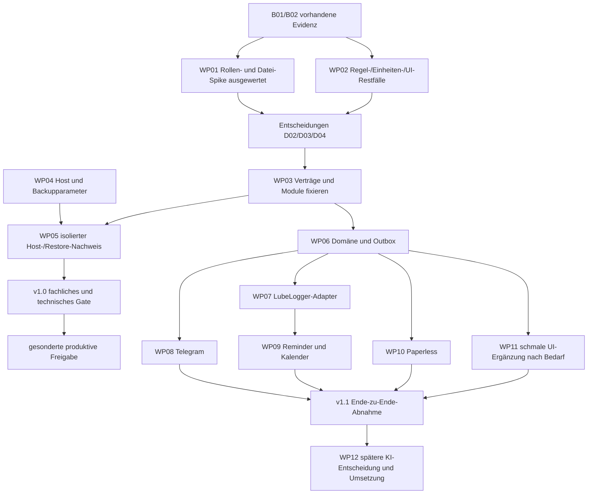

# Lieferplan mit Abhängigkeiten und überprüfbaren Paketen

Stand: 2026-10-27. **Planung, keine Produktivfreigabe und kein Zeitversprechen.** Ein Cloudflare-Login, danach globale Adminrechte: [ADR-0008](../adr/0008-single-user-access.md). Frühere Read-only-Gateway-/Mehrnutzer-Gates unten sind historisch und für die Rollenklärung überholt. Die bisherigen B01/B02-Ergebnisse bleiben unverändert. Aufwand S/M/L bezeichnet nur relative Größe für eine Person: S lokal begrenzte Änderung, M mehrere Module/Verträge, L externe Systeme oder größere Ungewissheit. Keine belastbaren Stunden-/Eurozahlen ohne Host-, UI- und Providerentscheidungen.

## Reihenfolge und kritischer Pfad

Die Reihenfolge ist phasenbezogen; unabhängige Dokumentation und Tests können parallel laufen. LubeLogger mit nativer Adminoberfläche bleibt der bevorzugte v1.0-Ausgangspunkt. Eine eigene Ergänzung wird bei belegter fachlicher Lücke abgewogen. Die Anforderungen an Änderungsprotokoll und den tatsächlichen Cloudflare-/Originzugang bleiben separat nachzuweisen.

## Arbeitspakete für folgende Aufträge

| Paket / Größe / bestehender Backlog | Konkreter nächster Umfang | Reviewbares Ergebnis und Abnahme | Bewusst außerhalb |
| --- | --- | --- | --- |
| WP01 / M–L / B03/B16 | Rollen- und Datei-Spike als historische Providercharakterisierung durchgeführt | [42 Checks](../discovery/wp01-runtime-verification.md). Der Nutzer benötigt keine Read-only-Rollentrennung mehr; echte Access-/Origin-Grenze bleibt zu prüfen | Keine Produktivproxykonfiguration aus dem Testableiten |
| WP02 / M / B02/B04/B07/B17 | LubeLogger als Admin mit fünf Testfahrzeugen, Teilen/Kosten/Einheiten/Audit und Browser prüfen | [Funktionsprüfung](../discovery/wp02-functional.md), [Auditprüfung](../discovery/wp02-audit-assessment.md); Browser-/Priorisierungs- und weitere Restfälle gesondert dokumentieren | Kein echter Fahrzeugschein, keine rechtliche HU-Regel aus Beispieldaten |
| WP03 / S–M / B18 | API-/Payload-/ID-/Zustandsverträge, gewählte Datenhoheit und Modulgrenzen nach Entscheidungen fixieren | Lokale Schema-/Beispielprüfung, Versions-/Capabilitytabelle, kurze Änderungsnotiz in ADRs; keine private LL-Route als Garage-Adapter | Keine umfangreiche Codegenerierung ohne festgelegten Vertrag |
| WP04 / S / B05 | Homelabparameter, VM/LXC, Identity, Secret-/Offsite-Ziel und RPO/RTO/Retention aufnehmen | Ausgefülltes redigiertes Inventar, Ressourcen-/Speicherannahmen, Verantwortlicher; keine Tokens in Git | Keine Konto-/Domainanlage |
| WP05 / M / B06/B08 | Konkrete gepinnte Konfiguration zunächst in isoliertem Gast, Auth/Origin/Netze und konsistente Backup-/Restore-/Upgradeprozesse | Start-/Stopp-/Readiness-/Negativtests, gemessener Restore mit Daten/Anhängen/Keys, kein Wiederholungsversand; Konfiguration zur späteren Freigabe | Cloudflare-/Produktivänderungen erst nach ausdrücklicher Freigabe |
| WP06 / M / B10/B18 | Ein modulärer Garage-Kern: Problemlog, stabile IDs/Revisionen, bestätigte Durchführungen, Audit, Inbox/Outbox, persistenter Operationszustand | Transaktions-/Parallelitäts-/Abbruchtests; alle externen Adapter zunächst kontrollierte Test-Doubles; Domänenrollen unabhängig vom Transport | Noch kein Bot-/KI-Aufruf, keine zweite Fahrzeug-/Kostenhoheit |
| WP07 / M–L / B02/B10 | Minimaler offizieller LL-Adapter für geprüfte Capabilities, zuerst Read und km-Write; danach Wartung nur im belegten Umfang | Roundtrip/401/403/2xx-Fehlerobjekt/Antwortverlust/Drift, unbekannter Writeausgang bleibt sichtbar; bestehende 62 Checks passend wiederverwenden | API-Teilerequisition und vollständige native Wiederholung ohne Nachweis nicht zusagen |
| WP08 / M / B11 | Long-Polling, dauerhafte Inbox/Offset, strukturierte Befehle, Vorschau/Bestätigung, Zustand und Hilfe | Fremde ID/Chat/Replay/Ablauf/Concurrency ohne Wirkung; Neustart verarbeitet kein Update doppelt; Templates und Zustellunsicherheit geprüft | Natürliche Sprache zunächst optional und ohne Autowrites; kein Video |
| WP09 / M–L / B04/B12/B17 | Ein Rule-Owner, reine Fachberechnung, täglicher Berlin-Job, Zustelljournal; HU-Kalenderprojektion nach D06 | Deterministische Vektoren, stabile Haupt-/notice30-IDs, ETagkonflikt, Revisionverwerfung, Ausfallnachholung; kein doppelter Scheduler | Keine pauschale 24-Monats-HU-Regel; kein Garantieversprechen externer Exactly-once-Zustellung |
| WP10 / M / B09/B16 | Paperless-Leseadapter und Dokument-ID-Verknüpfung; Zugang über denselben Cloudflare-Adminpfad | Angemeldeter Abruf, nicht über Access zugelassener Zugriff, Fehllink/Restore; Originale möglichst nicht dupliziert | Kein automatischer Massenimport oder Löschung bestehender Dokumente |
| WP11 / M / B07/B13 | Nur belegte Lücken: Ampel/Fälligkeiten/Logbuch/Bestätigungsstatus, native Seiten für bereits geeignete Funktionen | Mobile/Keyboard/Fehler-/stale-Zustände und zwölf UI-Szenarien; native Adminwrites bleiben verfügbar, gezielte Assistentenänderungen sind bestätigt und protokolliert | Kein zweites vollständiges LubeLogger-Frontend |
| WP12 / L / B14/B15 | Zuerst Anbieter-/Datenschutz-/Budgetentscheidung; dann read-only Recherche/Diagnose/OCR mit freigegebenem Kontext | Quellen-/Unsicherheits-/Injection-/OCR-/Kostenlimit-Tests; Nutzer bestätigt jede Änderung | Kein Diagnosefakt aus Plausibilität, kein automatischer OBD-Zugriff |

## Modulare Backend-Struktur als Zielentwurf

Ein Repository/ein auslieferbares Garage-Artefakt; keine getrennten Datenbanken pro Modul. Vorschlag für spätere Java-Pakete: `identity`, `vehicles`, `maintenance`, `logbook`, `commands`, `audit`, `integrations.lubelogger`, `integrations.paperless`, `integrations.calendar`, `telegram`, `notifications`, später `ai`. Reine Domänenberechnung hängt nicht von Spring, Telegram oder Provider-DTOs ab. Adapter implementieren schmale Ports, Fehler werden in stabile Domänen-/Operationszustände übersetzt.

Transportcontroller dürfen weder Credentials selbst auswählen noch direkt Provider-Clients anrufen. KI erhält nur ausdrücklich erlaubte read-only Ports. Gemeinsame technische DTOs nicht zu einem allwissenden `common`-Paket ausweiten; Datum, Geld, IDs und Zustände zentral spezifizieren. Build-/JDK-/Spring-/DB-/Testlibrary-Versionen erst vor Umsetzung anhand offizieller Kompatibilitätsangaben fixieren; keine Version aus dieser Planung erfinden.

## Wann parallel gearbeitet werden kann

Nach WP03 können Domain/Outbox, LL-Read-Adapter, Bot-Testtransport und UI-Testansichten parallel gegen vereinbarte Fixtures entstehen. Vorher nur unabhängige Read-only-Spikes/Planung. Pro Agent/Änderung eindeutige Dateien/Module; gemeinsame Schemas/ADRs durch einen Koordinator. Jeder Integrations-PR erklärt Trigger, Verhalten, Verträge, Nachweis und bekannte Grenzen.

Kleine Reviewfolge für WP06/07: reine Fachwerte/Zustände → Persistenz-/Transaktionsgrenzen → Readadapter → Entwurf/Bestätigung → einziger freigegebener Write → Antwortverlust/Restart → Oberfläche. Ein PR darf ein bekanntes B16/B03-Gate nicht durch grüne Happy-Path-Tests implizit als gelöst ausweisen.

## Risiken, die keine Vorplanung wegentscheidet

- **API-Fähigkeit:** Öffentliche LL-API kann Teileverwendung/Recurrence nicht vollständig abbilden. Native Adminoberfläche kann diese Funktionen anbieten; ein späterer Telegram-Assistent darf sie nicht als automatisch ausführbar zusagen. Ein Gateway nur für unterschiedliche Webrollen wird nicht benötigt.
- **V1.0-Umfang:** Änderungsprotokoll, Ampel und Zahlungsverlauf können gezielte Garage-/Paperless-Ergänzungen erforderlich machen. Eine eigene Oberfläche ausschließlich zur Unterscheidung angemeldeter Nutzer entfällt.
- **Datenqualität:** Quelleneignung, Tachoersatz/-korrektur, fehlende Historie und unbekannte Herstellerintervalle benötigen fachliche Nutzerklärung. Mehr Automatisierung kompensiert keine fehlende Quelle.
- **Betrieb:** unbekannter Host, Paperless-Version, Identity und Offsite-Ziel verhindern belastbare Ressourcen-/RTO-/Kalender-Zustellaussagen.

## Abnahme und Übergabe je Meilenstein

Ein Meilenstein enthält Konfigurations-/Quell-SHA, Images/Versionen, synthetische Fixtures, Ergebnisse mit pass/gap/fail, Bedienpfad und Runbookänderung. Produktive Secrets bleiben außerhalb. Zuständige Requirements im [Backlog](../backlog.md) zuordnen. Nur tatsächlich erfüllte Teilanforderungen abhaken; Freigabe nach AGENTS.md bleibt ein eigener letzter Schritt nach konkretem reviewbarem Ergebnis.

Der nächste Fokus sind die verbleibenden WP02-UI-/Fachfälle und die konkrete Vorbereitung von Cloudflare-/Origin- und Recoverytests; keine Mehrnutzer-Read-only-Architektur aufbauen.

## Fortschreibung WP01 — 2026-10-27

Der [erste praktische Spike](../discovery/wp01-runtime-verification.md) ist ausgewertet (42 Checks, 28 pass/14 gap). Die native Nur-Lesen-Hypothese ist widerlegt; globale Audit-/Dokumentgates bleiben offen. Es wäre nicht sinnvoll, dieselbe Rollenannahme ohne neue Schutzoption erneut als gelöst vorauszusetzen. Die damalige Empfehlung eines frühen Garage-Zugangs wegen Nutzerrollen ist durch die Ein-Admin-Klarstellung überholt. WP02-Einheiten-/UI-/Kostenfälle und der benötigte Zugangsschutz bleiben separat relevant.

## Neu priorisiert nach Nutzerklärung

1. LubeLogger-Basisoberfläche und funktionale Restfälle mit synthetischen Daten abnehmen (WP02/B07/B19).
2. Vorhandenes Änderungsprotokoll anhand von REQ-043 und Problemhistorie anhand REQ-020 prüfen; fehlende Funktionen getrennt dokumentieren. Kein eigenes UI nur für verschiedene angemeldete Nutzerrollen.
3. Technischen Ein-Login-Weg, private Origin-/Dienstnetze, Authentifizierungs- und Wiederherstellungstests konkretisieren. Native Auth off ist nur unter geprüften Netzwerk-/Tokenannahmen sinnvoll; SSO ist eine Alternative, deren Kompatibilität noch nachzuweisen ist.
4. Danach kleine funktionale Ergänzungen für tatsächlich fehlende Anforderungen priorisieren; die Phasen für Telegram und KI bleiben bestehen.

Alte WP01-Read-only-Tests bleiben Evidenz, aber ihr vorheriger Produktblocker zur Rollentrennung entfällt. Sie lösen nicht die Datennebenwirkungen, das Änderungsprotokoll oder die Anforderungen an den Cloudflare-Eingang. Produktionsbereitstellung und Cloudflare-Änderungen erfordern weiterhin die in AGENTS.md genannte explizite Freigabe.
