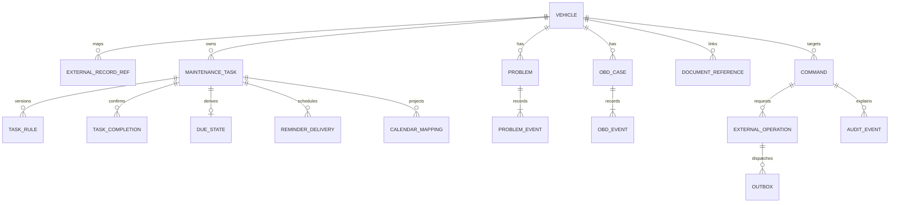

# Domänen- und Persistenzmodell — vorgeschlagener Zielentwurf

Stand: 2026-10-26. **Nur Planung; kein Schema angelegt, keine Migration, keine Implementierung.** Grundlage sind Requirements, Architektur, ADR-0001–0005 und der [B01/B02-Laufzeitbericht](../discovery/lubelogger-runtime-verification.md). Die Tabellen sind ein umsetzungsnaher Vorschlag für v1.1 mit PostgreSQL nach ADR-0002, keine akzeptierten Architekturentscheidungen.

Fortschreibung 2026-10-27: Laut [ADR-0008](../adr/0008-single-user-access.md) erhält jeder über Cloudflare zugelassene Webnutzer Adminrechte. Eine Fahrzeug- oder Dokumenttrennung zwischen diesen Webnutzern ist keine Produktanforderung. Fahrzeugzuordnungen und Referenzintegrität bleiben fachlich notwendig; Telegram hat einen eigenen Zugang. Die unten beschriebenen späteren Persistenz- und Auditvorschläge sind dadurch nicht bereits beschlossen.

Bestand: LubeLogger trägt Fahrzeuge, Kilometer und Vorgangskosten; öffentliche API-Lücken, native Dokumentberechtigung und unvollständiges Audit sind nachgewiesen. Vorgehen: Datenhoheit begrenzen, stabile Identitäten und transaktionale Aggregate definieren, danach Fachregeln und deterministische Vektoren in [due-date-spec.md](due-date-spec.md) festhalten. Annahmen: eine autorisierte Person, mehrere Fahrzeuge, kein Mehrmandantenbetrieb, UTC-Zeitpunkte und Europe/Berlin für Fachkalendertage.

## Datenhoheit und Übergang

| Bereich | Vorgeschlagener Owner | Konsequenz |
| --- | --- | --- |
| Fahrzeugstammdaten, originale Kilometerbelege, Wartungs-/Reparaturbelege, Teilebestand und Vorgangskosten | LubeLogger | Garage speichert Referenzen, bestätigte Aufträge und als solche bezeichnete Beobachtungen; keine zweite editierbare Stammdaten-/Kostenkopie. |
| Wartungsregeln, bestätigte Quellen, fachliche nächste Fälligkeit | **Garage ab v1.1 empfohlen**, Entscheidung B04/ADR-0001 offen | LubeLogger bekommt höchstens konkrete nächste Reminder als Projektion. Wiederholung und GET-Autorefresh dort aus; keine zwei fortschreibenden Regelwerke. |
| Technisches Logbuch, OBD-Ereignisse, Bestätigungen, Audit/Integrationszustand | Garage | Eigene Transaktionen, Ereignishistorie und Rechteprüfung. |
| Originaldokumente und Dokumentrechte | Paperless-ngx empfohlen, B09/B16 offen | Garage hält ID/Verknüpfung; keine sensiblen Dateien in ungeprüften nativen LubeLogger-Pfaden. |
| Kalender | Abgeleitete externe Projektion | Manuelle Kalenderänderung ist weder Wartungsdurchführung noch neue Regel. |
| KI | Vorschlagsspeicher in Garage, frühestens v2.0 | Ohne fachliche Bestätigung keine gültige Regel, Diagnosefakt oder Statusänderung. |

**v1.0 bleibt offen:** native LubeLogger-Regeln unter bekannten Anzeigegrenzen oder vorgezogene Garage-Regelverwaltung sind gegeneinander zu entscheiden. Dieser Entwurf plant den empfohlenen späteren Zielzustand und erklärt v1.0 nicht für freigegeben. Bei Übergang jede Regel mit Quelle, Anker, nächste Fälligkeit und Owner bestätigen; alte Fortschreibung deaktivieren und Mappings erst danach aktivieren. Ein manueller Wiederholungs-/Schwellwertwert darf nicht aus dem unvollständigen API-GET erraten werden. Übergang benötigt einen gesondert autorisierten, überprüfbaren Plan; hier findet er nicht statt.

## Identitäten, Revisionen und Datentypen

Garage-IDs sind zufällige UUIDs und bleiben bei Restore erhalten. Provideridentität ist immer `(providerInstanceId, resourceType, externalId)`, niemals Kennzeichen, Dokumenttitel oder Beschreibung. `externalId` ist String, auch wenn der aktuelle Provider Zahlen nutzt. URLs werden aus konfigurierter vertrauenswürdiger Instanz und ID aufgebaut, nie als beliebiger vom Nutzer gelieferter Abrufpfad.

Zeitpunkte sind `Instant`/UTC; fachliche Daten `LocalDate`. Distanz hat explizite Einheit und Quelle; der MVP akzeptiert Kilometer, Betriebsstunden sind kein Distanzwert. Geld ist Dezimalwert mit Währung, nie Float. Vorgeschlagen: Geld `numeric(19,2)`, Mengen `numeric(19,3)`, Kilometer als nichtnegative ganze Zahl; andere Einheiten brauchen gesondert bestätigte Normalisierung. Ein fest definierter interner Vorschlag ist keine Behauptung über vollständige Upstream-Feldvalidierung.

`vehicleRevision`, `commandRevision`, `ruleRevision` und `dueRevision` sind **verschiedene** nichtnegative Versionszähler. `vehicleRevision` bezeichnet Garage-Snapshot/Zuordnungsstand, kein zugesagtes Provider-ETag. `dueRevision` ändert sich bei bestätigter Regel-/Frist-/Durchführungsänderung, nicht bei täglichem Countdown oder neuer Prognose. Für abgeleitete Anzeigen existiert eine eigene `projectionRevision`.

## Relationen

`DUE_STATE` und aktuelle Problem-/OBD-Statusfelder sind neu berechenbare Projektionen. Regelversionen, Bestätigungen, abgeschlossene Ereignisse und Audit werden ergänzt, statt still überschrieben. Das ist kein vollständiges Event-Sourcing aller LubeLogger-Daten.

## Tabellenentwurf

`id` bedeutet UUID-PK, Zeitstempel `...At` bedeuten UTC. FKs innerhalb eines Fahrzeugaggregats müssen zusätzlich gleiche `vehicleId` erzwingen, etwa durch zusammengesetzte FKs auf `(id, vehicleId)`. Kein generischer frei beschreibbarer `entityType/entityId`-Verweis ersetzt Integritätsprüfung.

| Tabelle | Wesentliche Felder | Constraints / Zugriff |
| --- | --- | --- |
| `actor` | `id`, `identityIssuer`, `identitySubject`, `enabled`; Telegram-Identität als numerische ID separat zugeordnet | Unique Issuer/Subject; keine Passwörter/Tokens; deaktivierter Actor kann nicht bestätigen. Kein Mehrbenutzerfeature wird damit zugesagt. |
| `provider_instance` | `id`, `kind`, `trustedBaseUrl`, `capabilityVersion`, `enabled`, `credentialReference` | Secret nur extern referenzieren; keine Zugangsdaten in URL. Änderungen administrativ, auditiert. |
| `vehicle` | `id`, `ownerActorId`, `lubeInstanceId`, `lubeVehicleId`, `vehicleRevision`, `active`, `snapshot`, `snapshotReadAt`, `snapshotHash` | Unique Instanz/Fahrzeug-ID; Snapshot nur Adapter-beschreibbar, alter Lesestand sichtbar. Rechte vor jedem Lesen/Schreiben; PK erteilt kein Recht. |
| `external_record_ref` | `id`, `vehicleId`, `providerInstanceId`, `resourceType`, `externalId`, `observedHash`, `lastSeenAt`, `availability` | Unique Instanz/Typ/ID; Löschen upstream markiert `missing`, entfernt keine Garage-Historie. Kein direktes Provider-DB-FK. |
| `odometer_observation` | `id`, `vehicleId`, `externalRecordRefId`, `readAt`, `recordedOn`, `rawValue`, `rawUnit`, `normalizedKm`, `distanceEpoch`, `observedHash`, `supersedesObservationId`, `validationState` | Read-only Providerbeobachtung, nicht zweites editierbares Kilometerbuch. Unique Referenz/Hash; Korrekturen als neue Beobachtung. Nur bestätigte, nicht supersedierte Daten für Prognose; Unit-/Epoch-Wechsel braucht Bestätigung. |
| `source_reference` | `id`, `sourceKind`, `title`, `url` oder `documentReferenceId`, `retrievedOn`, `applicability`, `evidenceHash`, `reviewedBy`, `reviewedAt` | `sourceKind=manufacturer/user/official_notice`; Herstellerregel nur mit passender verifizierter Quelle. Nutzerintervall ausdrücklich als solches; keine erfundene Herstellerherkunft. |
| `maintenance_task` | `id`, `vehicleId`, `kind`, `title`, `ownerMode`, `lifecycle`, `currentRuleRevision`, `dueRevision`, `occurrenceIndex` | `kind=maintenance/hu/tax/insurance/custom`; `ownerMode=LL_NATIVE/GARAGE`; nur ein aktiver Owner. Stabile `taskId` über Durchführungszyklen. |
| `task_rule` | `(taskId, ruleRevision)`, `vehicleId`, `sourceReferenceId`, `recurrenceMode`, `intervalMonths` oder `intervalDays`, `intervalKm`, `anchorDate`, `anchorKm`, `initialDueDate?`, `initialDueKm?`, `duePrecision`, `effectiveFrom`, `createdBy`, `createdAt`, `supersedesRevision` | Immutable; positive Intervalle, Monate/Tage nie zugleich; mindestens eine Datums-/km-Grenze. `one_off/fixed_anchor/after_completion`; Anfangsfälligkeit bei One-off über `initialDueDate`/`initialDueKm` explizit. `duePrecision=day/month/not_applicable` erhält bestätigte Monatsprecision; HU-Folgetermin kann als neue bestätigte One-off-Regelversion angelegt werden, ohne Rechtsintervall zu erfinden. Keine Monatszahl implizit als 30 Tage behandeln. |
| `task_completion` | `id`, `taskId`, `vehicleId`, `occurrenceIndex`, `ruleRevisionAtConfirmation`, `performedOn`, `odometerKm?`, `confirmedBy`, `confirmedAt`, `sourceReferenceId?`, `externalRecordRefId?`, `commandId`, `supersedesCompletionId?`, `correctionReason?` | Immutable fachliche Nutzerbestätigung; Unique Command/Task und genau eine ursprüngliche Bestätigung pro Task/Zyklus. Unique nichtleerer `supersedesCompletionId` verhindert Korrekturforks; effektiver Kopf jeder Kette wird daraus abgeleitet. Bestätigung kann lokal gelten, während LL-Beleg noch `pending` ist; Synczustand separat anzeigen. |
| `due_state` | `taskId`, `vehicleId`, `ruleRevision`, `dueRevision`, `occurrenceIndex`, `dueDate?`, `duePrecision`, `dueKm?`, `evaluationStatus`, `latestEffectiveCompletionId?`, `basisHash`, `projectionRevision`, `computedAt` | Genau eine aktuelle Zeile/Task, transaktional aktualisiert. Fälligkeit enthält mindestens eine Grenze; fehlende/strittige Quelle ergibt `requires_review` statt errechneter Tatsachenfrist. |
| `problem` | `id`, `vehicleId`, `currentStatus`, `currentSeverity`, `revision`, `openedOn`, `title` | Status `open/observing/resolved`; Severity-Katalog mit stabiler ID und konfigurierbarer Darstellung/Priorität, initial Auffälligkeit/reparaturbedürftig/kritisch. Aktuellfelder aus Events ableitbar. |
| `problem_event` | `id`, `problemId`, `vehicleId`, `sequence`, `eventType`, `occurredOn`, `odometerKm?`, `description`, `newStatus?`, `newSeverity?`, `actorId`, `createdAt`, `supersedesEventId?`, `commandId` | Unique Problem/Sequenz und Command/Eventrolle. Ereignisse für Beobachtung, Diagnoseversuch, Reparatur, Status/Schweregrad und Korrektur; append-only. Kritisch nur bestätigte Person oder nachvollziehbare freigegebene Fachregel, kein KI-Automatismus. |
| `problem_link` | `earlierProblemId`, `laterProblemId`, `vehicleId`, `relation`, `confirmedBy`, `confirmedAt` | Unique Paar/Relation, keine Selbstverknüpfung, beide Fälle gleiches Fahrzeug; frühere Ursache wird nicht automatisch als aktuelle Diagnose übernommen. |
| `obd_case` | `id`, `vehicleId`, `codeSystem`, `normalizedCode`, `currentStatus`, `revision` | Unique Fahrzeug/System/Code; keine stillschweigende Bedeutungserfindung oder Normprüfung aus einem String. Status `active/cleared/recurred`, aus Events ableitbar. |
| `obd_event` | `id`, `obdCaseId`, `vehicleId`, `sequence`, `eventType`, `observedAt?`, `observedOn`, `rawCode`, `status`, `problemId?`, `documentReferenceId?`, `actorId`, `commandId` | Unique Case/Sequenz; OCR-Extrakt erst als Vorschlag, nach Nutzerbestätigung Ereignis. `cleared` heißt Code als gelöscht bestätigt, nicht Problem behoben; erneutes Auftreten bleibt Historie desselben Cases. |
| `document_reference` | `id`, `vehicleId`, `paperlessInstanceId`, `externalDocumentId`, `category`, `problemId?`, `externalRecordRefId?`, `status`, `lastVerifiedAt` | Nur ID/Metadaten, keine Datei/OCR-Kopie. Mindestens Fahrzeugbezug, optionale Vorgangsverknüpfungen mit gleichem Fahrzeug. Rechte bei jedem Abruf erneut prüfen; `missing/forbidden` ohne Inhaltscache anzeigen. |
| `command` | `id=commandId`, `vehicleId`, `operation`, `payload`, `payloadHash`, `expectedVehicleRevision`, `expectedAggregateRevisions`, `commandRevision`, serverseitige `actorId/channel/chatId`, `expiresAt`, `confirmedAt?`, `status` | Stabil ab Entwurf. Client darf Actor/Chat/Bestätigung nicht bestimmen. Bestätigung bindet Inhalt, Ziel, Revision und Ablauf; immutable akzeptierte Nutzlast. Zustände siehe unten. |
| `external_operation` | `id=operationId`, `commandId?`, `taskId?`, `providerInstanceId`, `effectRole`, `desiredRevision`, `payloadHash`, `status`, `externalRecordRefId?`, `attemptCount`, `lastErrorClass`, `nextAttemptAt` | Unique Command/Provider/Effektrolle bzw. Task/Provider/Rolle/Zielrevision. Ein Auftrag darf mehrere unabhängig sichtbare Effekte haben; kein Exactly-once-Versprechen. |
| `outbox` | `id`, `operationId`, `availableAt`, `leaseOwner?`, `leaseUntil?`, `attempt`, `createdAt` | Unique Operation für aktiven Dispatchauftrag. In derselben DB-Transaktion wie gewünschter Fachzustand/Audit anlegen. Worker-Lease ist keine Provider-Idempotenz. |
| `inbox` | `(channel, providerUpdateId)`, `actorId?`, `receivedAt`, `status`, `commandId?`, `redactedPayloadHash` | Unique Update; dauerhaft aufnehmen vor Offsetfortschreibung. Keine unbegrenzte Speicherung privater Nachrichten. |
| `reminder_policy` | `id`, `taskId` oder globaler Default, `channel`, `offsetDays`, `enabled`, `policyRevision` | Pro Task/Kanal/Offset genau eine wirksame Regel; Offset nichtnegativ; Defaults über explizite Priorität, keine versehentliche Zusammenführung. Änderungen versioniert. |
| `reminder_delivery` | `id`, `taskId`, `dueRevision`, `channel`, `offsetDays`, `scheduledOn`, `status`, `operationId`, `sentAt?` | Unique `(taskId,dueRevision,channel,offsetDays)`; pro Taskrevision keine Doppelanlage. Unklare Zustellung gesondert behandeln, keine Garantie externer Deduplizierung. |
| `calendar_mapping` | `id`, `taskId`, `calendarInstanceId`, `calendarId`, `role`, `eventId`, `etag?`, `desiredDueRevision`, `syncedDueRevision?`, `syncStatus` | Unique Kalender/Task/Rolle und Kalender/Event-ID. Rollen `main` und **nur nach Entscheidung** `notice30`. Mapping stabil über Taskzyklen, kein neues Haupt-Event pro Wiederholung. |
| `audit_event` | `id`, `vehicleId?`, `commandId?`, `operationId?`, `actorId`, `action`, typisierte Zielreferenzen, `recordedAt`, `beforeHash?`, `afterHash?`, minimales Änderungsdelta, `outcome`, `correlationId` | Append-only Anwendungsrolle; keine Tokens, Dokumentinhalte oder vollständigen Chattexte. Audit schreibt bestätigte Änderungen/Ergebnisse; Reconciliation wird als Beobachtung gekennzeichnet, nie als verifiziertes ursprüngliches Änderungsereignis. |

Audit-/Problem-/Regelhistorie darf die Anwendung nicht frei überschreiben. Administrative Retention, Löschung und Backupzugriff bleiben eine eigene offene Betriebsentscheidung; „append-only“ ist keine behauptete Unveränderlichkeit gegenüber DB-Administratoren. Die LubeLogger-Web-Auditlücke B03 bleibt durch diese Garage-Tabellen **ungelöst**.

## Zustands- und Transaktionsregeln

`command.status`: `awaiting_confirmation → accepted → executing → succeeded | partially_succeeded | failed | uncertain`. Vor Annahme zusätzlich `cancelled | expired | conflict`. Ein erneuter gültiger Bestätigungsklick liefert denselben Command; er erzeugt keinen neuen Effekt. Bestätigung prüft transportabhängig Web-Session/CSRF oder Telegram-Allowlist/private Chatbindung sowie aktive Berechtigung, `commandRevision`, `expectedVehicleRevision`, betroffene Task-/Problem-/OBD-Revisionen, Ablauf und Payloadhash atomar. Abhängige Revisionen werden beim Entwurf serverseitig als `expectedAggregateRevisions` aufgenommen und in die Bestätigung gebunden; ein unveränderter Fahrzeug-Snapshot allein schützt nicht vor gleichzeitig geänderten Regeln. Eine neue/änderte Nutzlast erhält neuen bestätigungspflichtigen Entwurf statt stiller Änderung eines akzeptierten Commands.

`external_operation.status`: `pending → in_flight → succeeded | failed | uncertain`; `cancelled` nur wenn noch kein ungeklärter externer Effekt besteht. Ein Prozessabbruch nach möglichem Provider-Schreibabschluss führt zu `uncertain`. Der Worker darf unklare nicht-idempotente POSTs nicht automatisch neu senden. Abgleich mit hinreichend eindeutiger Referenz oder manuelle Entscheidung erzeugt ein neues Auditereignis. Der Command ist `partially_succeeded`, wenn einige bekannte Effekte erfolgreich und andere endgültig fehlgeschlagen sind; mindestens ein unklarer erforderlicher Effekt hat Vorrang als `uncertain`.

Lokale Fachbestätigung, Audit, neue `due_state` und Outbox werden gemeinsam gespeichert. Die bestätigte tatsächliche Durchführung ist von der externen Beleganlage zu unterscheiden: „durchgeführt, LubeLogger-Synchronisierung ausstehend/fehlgeschlagen“ darf angezeigt werden, „in LubeLogger gespeichert“ erst nach geprüftem Erfolg. Ein Timeout rollt tatsächliche Nutzerangaben nicht still zurück und veranlasst keine zweite Wartung. Kosten erscheinen erst bei bestätigtem Providerbeleg in dessen Vorgangskostenansicht, bis dahin explizit als ausstehend.

Problem- und OBD-Ereignis plus aktueller Snapshot sowie Audit werden atomar fortgeschrieben; konkurrierende Revision führt zu Konflikt. Problemstatus-Anzeigen sind offen/beobachtet/behoben bei Werten `open/observing/resolved`. Eine bestätigte Wiederöffnung erzeugt ein neues Statusereignis; wiederkehrende Fälle können alternativ als neue verknüpfte Probleme erfasst werden, ohne alte Diagnose als bewiesen zu übernehmen. OBD: erste bestätigte Beobachtung `active`, bestätigtes Löschen `cleared`, bestätigtes erneutes Auftreten nach Löschen `recurred`; weitere Beobachtung desselben aktiven Codes erzeugt Historie, keinen neuen Fall. OBD-Löschung behebt kein Problem automatisch. Code-Normalisierung beschränkt sich zunächst auf Whitespace/Schreibweise; Codebedeutung braucht eigene nachvollziehbare Quelle. Ein Provider-Vorablesen verringert Race-Risiken, ersetzt aber kein nicht vorhandenes Provider-Locking. Kalender-/Reminderprojektionen konsumieren nur die aktuelle `dueRevision`; veraltete ausstehende Operationen werden vor Versand verworfen, bereits gesendete als solche historisch erhalten.

## Offene Entscheidungen und Implementierungsgates

- ADR/B04: Regel-Owner und v1.0-Übergang, Quellfreigabe, Monats-/Erledigungsmodus; danach ER-Schema und Capability-Vertrag verbindlich machen.
- B03/B16: vollständige Auditabdeckung und sensible Dokumentpfade lösen; dieses Modell umgeht keine Providerlücke.
- ADR-0002: PostgreSQL vs. SQLite, Retention, stabile Status-/Severity-Kataloge, Datenvolumen und Indizes finalisieren. Kandidaten: `problem(vehicleId,currentStatus)`, `external_operation(status,nextAttemptAt)`, `outbox(availableAt)`, `audit_event(vehicleId,recordedAt)`, `odometer_observation(vehicleId,recordedOn)`.
- Cash-Zahlungshistorie ist nicht aus veränderlichem Teile-Restbestand beweisbar. Vor B07 entscheiden, ob belegte Zahlungsfelder/-beobachtungen reichen oder eine eigene, explizit führende Zahlungserfassung nötig ist; kein zweites editierbares Kostenledger still einführen.
- B11/B12: Cmd-/Outbox-Konkurrenz, unklarer POST, Datumsvektoren und Zustellstrategie mit synthetischen Daten prüfen. In diesem Schritt weder Dienste gestartet noch solche Tests ausgeführt.

`duePrecision=not_applicable` gilt ausschließlich ohne Datumsgrenze, etwa für reine Kilometeraufgaben. day/month bewahren die bestätigte Datumsgenauigkeit; ein operativer Monatsletzter ersetzt nicht die Originalpräzision.
